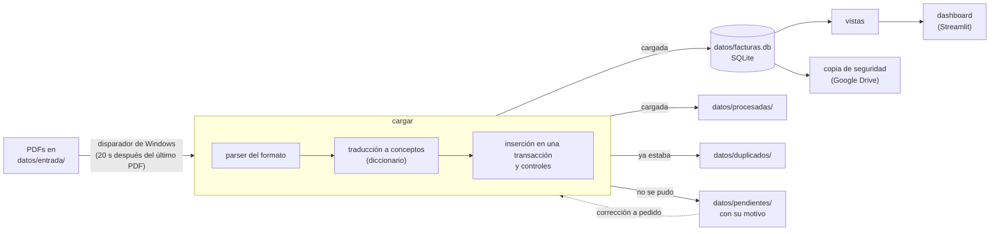

# facturas-bi

Convierte las facturas en PDF de los servicios de una vivienda (agua, luz, gas, fibra y móvil) en una base de datos SQLite para análisis, y muestra el gasto en un dashboard. Dejás los PDFs en una carpeta y el resto pasa solo: un parser determinista (sin LLM) lee cada factura, la carga valida que todo cuadre al céntimo, la base guarda los hechos, y el dashboard responde cuánto gastás y por qué. Lo que no se puede cargar queda apartado con su motivo, y una copia de seguridad se guarda en Google Drive después de cada carga.



**Esquemas** del proyecto y de la base de datos: *SOON*.

El código, los nombres y la documentación están en español; el dashboard, en inglés.

**Contenido**

- [Requisitos](#requisitos)
- [Instalación desde cero](#instalación-desde-cero)
- [Operación diaria](#operación-diaria)
- [Mantenimiento](#mantenimiento)
- [Plan B: propuestas de corrección con un agente](#plan-b-propuestas-de-corrección-con-un-agente)
- [Cómo replicarlo con otros datos](#cómo-replicarlo-con-otros-datos)
- [Cómo se construyó](#cómo-se-construyó)

## Requisitos

- Windows 11 con PowerShell 5.1 (viene con Windows). El disparador usa el Programador de tareas.
- [Python 3.12](https://www.python.org/downloads/) (la versión con la que se probó) con el lanzador `py`.
- [Git para Windows](https://git-scm.com/download/win).
- Opcional: [Google Drive para escritorio](https://www.google.com/drive/download/), para la copia de seguridad (cualquier carpeta sirve).
- Opcional: [Claude Code](https://claude.com/claude-code) con una suscripción, solo para el plan B.

Todo lo demás es gratuito y se instala con `pip`. No se usa ninguna API ni servicio de pago.

## Instalación desde cero

Todos los comandos son de PowerShell y se ejecutan desde la carpeta del proyecto.

1. **Descargar el proyecto** en una carpeta de ruta corta (por ejemplo, `C:\proyectos\`) y entrar en ella:

   ```powershell
   git clone https://github.com/amuchastpedro/hogar-bi.git facturas-bi
   cd facturas-bi
   ```

   La ruta corta importa: algunas dependencias tienen archivos con rutas internas largas y, si Windows no tiene activadas las rutas largas (viene así de fábrica), `pip` falla en el paso 3 con `No such file or directory`.

2. **Permitir los scripts de PowerShell** del usuario (una sola vez por equipo; no pide administrador):

   ```powershell
   Set-ExecutionPolicy -Scope CurrentUser RemoteSigned
   ```

   Si descargaste el proyecto como ZIP en lugar de clonarlo, Windows marca los scripts como descargados de internet; desbloquealos con `Get-ChildItem -Recurse | Unblock-File`.

3. **Entorno virtual y dependencias** (las versiones están fijadas en `requirements.txt`):

   ```powershell
   py -3.12 -m venv .venv
   .venv\Scripts\python -m pip install -r requirements.txt
   ```

4. **Hook contra datos personales** (bloquea un commit que contenga un DNI, un IBAN, un CUPS, un teléfono o un email):

   ```powershell
   git config core.hooksPath scripts/git_hooks
   ```

   Además, podés listar en `datos/datos_privados.txt` (fuera de git) los valores que no tienen un formato reconocible, como tu nombre, tu dirección o tus números de contrato: uno por línea.

5. **Carpetas de datos y copia de seguridad.** `datos/` queda fuera de git. Creá la carpeta de entrada y el archivo de configuración con la ruta de una carpeta de respaldo que ya exista:

   ```powershell
   New-Item -ItemType Directory datos\entrada
   Set-Content -Encoding utf8 datos\config.toml "carpeta_respaldo = 'G:\Mi unidad\facturas-bi-respaldo'"
   ```

   La ruta va entre comillas simples. Las copias contienen las facturas, así que esa carpeta no se comparte. Sin `config.toml` todo funciona igual, pero la carga avisa de que no hizo la copia.

6. **Crear la base**: la primera carga la construye desde las semillas del repositorio.

   ```powershell
   $env:PYTHONPATH = "src"
   .venv\Scripts\python -m facturas cargar
   ```

   Tiene que decir `No había base: se construyó.` y, con `datos/entrada/` vacía, `Resumen: 0 cargadas, …`.

7. **Instalar el disparador**, que carga solo lo que aparece en `datos/entrada/`:

   ```powershell
   scripts\instalar_disparador.ps1
   scripts\estado_disparador.ps1
   ```

   Son dos tareas del usuario, sin administrador. El vigilante se inicia al iniciar sesión y lanza la carga 20 segundos después del último PDF nuevo. Un barrido, cada hora y al iniciar sesión, recoge lo que se le haya escapado (por ejemplo, con el equipo suspendido).

8. **Comprobar** que todo funciona (unos 3 minutos):

   ```powershell
   .venv\Scripts\python -m pytest -q
   ```

   Los PDFs de ejemplo (`ejemplos/`) no se publican: sin ellos, unos 150 tests se saltan con el motivo y el resto tiene que pasar.

## Operación diaria

Los comandos de Python necesitan `$env:PYTHONPATH = "src"` en la sesión de PowerShell (una vez por sesión). Devuelven `0` si todo fue bien o no había nada que hacer, `1` si hay PDFs nuevos en `datos/pendientes/` y `2` si hubo un error del sistema.

### Cargar facturas

Dejá los PDFs en `datos/entrada/`, con cualquier nombre y en cualquier orden. Con el disparador instalado no hay que hacer nada más; sin él, ejecutá `.venv\Scripts\python -m facturas cargar`.

Cada PDF termina en uno de estos sitios:

| Carpeta | Qué significa |
|---|---|
| `datos/procesadas/` | Cargado. Va a una subcarpeta por tipo de factura y año (`agua\2026\`, `fibra_movil\2025\`…), con un nombre normalizado (período, formato y número). |
| `datos/duplicados/` | Ya estaba cargado (el mismo archivo o la misma factura). Nunca se borra; al lado queda un `.motivo.txt`. |
| `datos/pendientes/` | No se pudo cargar: un formato nuevo, un concepto desconocido, importes que no cuadran… El motivo está en `<nombre>.motivo.txt` (etapa, motivo y fecha). |

Después de una carga que cambió algo se hace la copia de seguridad.

### Notificaciones

El disparador avisa con una notificación de Windows:

- **Facturas**: `2 facturas cargadas`, `1 pendiente`, o las dos cosas.
- **Facturas: error**: un error del sistema (la base no abre, la carpeta de respaldo no está disponible…), con el detalle. No se reintenta solo.

Si no hubo cambios, no avisa. Cada aviso queda también en `datos/logs/disparador.log`. La carga escribe su propio log en `datos/logs/facturas.log`.

### Consultar el estado

```powershell
.venv\Scripts\python -m facturas estado
```

Muestra las facturas y el gasto por servicio, el último período cubierto por cada contrato, los meses incompletos (días cubiertos sobre días del mes, entre el primer y el último mes con gasto), los PDFs pendientes con su motivo y un control de integridad: que las líneas de cada factura sumen su total. Si ese control falla, sale con `2`.

### Arreglar un PDF pendiente

Un pendiente se arregla a pedido, nunca solo. Lo habitual es abrir Claude Code en la carpeta del proyecto y pedir, por ejemplo: «Mirá por qué se rechazó `datos/pendientes/<archivo>.pdf` y proponé la corrección». Suele ser un alias nuevo en el diccionario (`src/facturas/semillas/alias_concepto.csv`) o un ajuste del parser del formato. Con la corrección hecha y los tests pasando:

```powershell
.venv\Scripts\python -m facturas reprocesar --pendientes
```

Si cambiaron las semillas, primero reconstruye la base con el diccionario nuevo. Otra forma es el [plan B](#plan-b-propuestas-de-corrección-con-un-agente), que hace la propuesta en una rama aparte.

### Ver el dashboard

```powershell
scripts\dashboard.ps1
```

Se abre en el navegador (`http://localhost:8501`; otro puerto con `--server.port 8502`). Lee la base en solo lectura, así que puede estar abierto mientras se carga.

- **Overview**: ¿cuánto gasto? El gasto total y por servicio en un mes, un año, todo el histórico, el año en curso, los últimos 12 meses o un rango; el promedio mensual; la evolución mes a mes con los meses incompletos atenuados, la tendencia y la comparación con el año anterior.
- **Analysis**: ¿por qué gasto lo que gasto? Una pestaña por servicio (Water, Electricity, Gas y DIGI para fibra y móvil). Muestra el desglose por grupo de cargos y por concepto, el volumen (m³ o kWh) y el precio unitario efectivo, para separar «consumí más» de «subió el precio», y qué cambió entre dos facturas. En la luz, además, el consumo por franja horaria; en la luz y el gas, qué consumos vienen de lecturas estimadas.

Qué cargos son fijos o variables, y qué grupos se muestran, lo decide `src/facturas/dashboard/semantica.toml`, no la base.

## Mantenimiento

### Copias de seguridad

La carpeta de `datos/config.toml` tiene:

- `instantaneas/facturas_<marca>.db`: la base completa, con la marca de tiempo `AAAAMMDD_HHMMSS`;
- `instantaneas/ajustes_<marca>.json`: los datos cargados a mano (los alias de los contratos) en ese momento;
- `procesadas/`: una copia de los PDFs cargados.

Se conservan las últimas 30 instantáneas. `cargar` y `reprocesar --pendientes` respaldan solos cuando cargan algo; a mano:

```powershell
.venv\Scripts\python -m facturas respaldar
```

### Restaurar desde una copia

```powershell
.venv\Scripts\python -m facturas restaurar 20261009_132111
```

Acepta la marca o la ruta de un `facturas_<marca>.db`. Repone la base, `datos/ajustes_manuales.json` y los PDFs de `procesadas/` que falten. Si la instantánea está dañada o no corresponde, no cambia nada.

- **En un equipo nuevo:** instalá el proyecto (pasos 1 a 5), creá `datos/config.toml` con la carpeta de respaldo y ejecutá `restaurar <marca>`. No hace falta la carga del paso 6.
- **Una instantánea de otra versión del esquema** no se restaura: copiá a mano su `ajustes_<marca>.json` a `datos/ajustes_manuales.json` y sus PDFs a `datos/procesadas/`, y reconstruí la base.

### Reconstruir la base

```powershell
.venv\Scripts\python -m facturas reprocesar --todo
```

Vuelve a construir la base desde las semillas, los PDFs de `datos/procesadas/` y `datos/ajustes_manuales.json`. Si nada cambió, el resultado es idéntico. Sin la base anterior, todo sale igual salvo el nombre original con que llegó cada PDF; por eso, si perdiste la base, conviene restaurarla. Si la reconstrucción falla, la base anterior queda intacta.

### Cambiar el alias de un contrato

Cada contrato tiene un alias (`luz 1`, `movil 2`…) que es lo que se ve en el dashboard:

```powershell
.venv\Scripts\python -m facturas contratos
.venv\Scripts\python -m facturas contrato "movil 2" --alias "movil trabajo"
```

El cambio va a la base y a `datos/ajustes_manuales.json` a la vez, así que sobrevive a una reconstrucción. Es lo único que se carga a mano.

El alias por defecto se numera por orden de llegada dentro de cada servicio. Si un servicio tiene más de un contrato, una reconstrucción puede intercambiar los alias por defecto, y `reprocesar --todo` avisa cuáles. Para que no cambien, fijalos con `contrato <alias> --alias <alias>`: conviene hacerlo con todos después de cargar el histórico, y con cada contrato nuevo que aparezca.

### Agregar un proveedor a mano

Un proveedor o un formato de factura nuevo necesita:

1. Una fila en `src/facturas/semillas/proveedor.csv`, con su identificador fiscal (NIF/CIF) y su nombre.
2. Un parser en `src/facturas/parsers/`, con `FORMATO`, `VERSION`, `reconoce(documento)` y `extraer(documento)`, registrado en `PARSERS` de `src/facturas/parsers/__init__.py`. Solo lee el PDF y devuelve una «factura extraída» (`docs/diseno.md`, sección 11). Los parsers existentes sirven de modelo.
3. Si trae conceptos nuevos: filas en `concepto.csv` y en `alias_concepto.csv`, y su grupo en `src/facturas/dashboard/semantica.toml` (un test comprueba que no quede ninguno sin clasificar).
4. Un PDF de ejemplo en `ejemplos/` y sus tests.

Después: los tests, `.venv\Scripts\python -m facturas diccionario` (regenera `docs/diccionario.md`) y `reprocesar --pendientes`. Es el tipo de cambio que conviene pedirle a Claude Code con el PDF a la vista.

### El disparador

- Ver si está instalado y la última ejecución: `scripts\estado_disparador.ps1`.
- Quitarlo: `scripts\desinstalar_disparador.ps1`.
- Si movés la carpeta del proyecto, desinstalalo antes y volvé a instalarlo después: las tareas guardan la ruta.
- Dos copias del proyecto tienen tareas distintas y no chocan.
- Si la carpeta de respaldo no está disponible (por ejemplo, Google Drive sin sincronizar), avisa con un error y no reintenta.

### Dependencias

Las versiones están fijadas en `requirements.txt`. Los parsers dependen del texto que extrae `pypdf`; el del agua, además, de la sangría con que lo extrae. Antes de actualizar `pypdf`, ejecutá los tests con los PDFs de ejemplo presentes.

## Plan B: propuestas de corrección con un agente

Está en pausa: el disparador no lo lanza. Se puede usar a pedido para un PDF pendiente:

```powershell
scripts\plan_b.ps1 "datos\pendientes\<archivo>.pdf"
```

Lanza Claude Code, sin supervisión y con permisos limitados, en una rama `propuesta/<formato>-<AAAAMMDD-HHMM>` y en un worktree aparte (`..\facturas-bi-propuestas\<sufijo>\`). La rama principal no se toca. Al terminar escribe un informe en `docs/propuestas/<sufijo>.md` de esa rama y avisa con una notificación. Antes de lanzar comprueba que Claude Code use la sesión de la suscripción (`claude auth login`) y no una clave de API; si no puede, avisa y el PDF queda pendiente. Opciones: `-LimiteMinutos 30` y `-Modelo sonnet`. Con `-Simular` hace todo menos llamar a Claude Code, pero el intento queda registrado: usalo solo en una copia del proyecto. Los intentos quedan en `datos/plan_b_intentos.tsv` y el log en `datos/logs/plan_b.log`.

La propuesta se revisa con git. En los comandos, `<sufijo>` es lo que sigue a `propuesta/` en el nombre de la rama:

```powershell
git branch --list "propuesta/*"                                  # las propuestas
git show "propuesta/<sufijo>:docs/propuestas/<sufijo>.md"        # el informe
git diff "main...propuesta/<sufijo>"                             # los cambios
```

**Aprobar:**

```powershell
New-Item -ItemType Directory -Force ejemplos\plan_b
Copy-Item "..\facturas-bi-propuestas\<sufijo>\ejemplos\plan_b\<sufijo>.pdf" ejemplos\plan_b\   # el PDF que usan los tests nuevos
git merge --no-ff "propuesta/<sufijo>"
.venv\Scripts\python -m pytest -q
```

Si los tests fallan, deshacé la integración con `git reset --hard ORIG_HEAD`. Si pasan, cargá el pendiente y quitá el worktree y la rama:

```powershell
.venv\Scripts\python -m facturas reprocesar --pendientes
. .\scripts\comun_plan_b.ps1; Quitar-Worktree "..\facturas-bi-propuestas\<sufijo>" "propuesta/<sufijo>"
```

Si la propuesta cambió un parser, ejecutá además `reprocesar --todo`, que vuelve a leer todos los PDFs con el parser nuevo. Si falla, la base queda como estaba y podés deshacer la integración con `git revert -m 1 HEAD`.

**Rechazar:**

```powershell
. .\scripts\comun_plan_b.ps1; Quitar-Worktree "..\facturas-bi-propuestas\<sufijo>" "propuesta/<sufijo>"
```

`Quitar-Worktree` quita primero el enlace al entorno virtual que tiene el worktree. Un borrado a mano podría vaciar el `.venv` del proyecto. El PDF queda en `datos/pendientes/` y el intento queda registrado, así que no se reintenta solo.

## Cómo replicarlo con otros datos

El proceso es genérico: lo específico de este caso está en [`caso_hogar.md`](caso_hogar.md), en las semillas (`src/facturas/semillas/`), en los parsers y en el dashboard. Para otro conjunto de facturas, por ejemplo las de proveedores de una pequeña empresa:

1. Copiá a una carpeta nueva `tarea.md`, `requisitos.md`, `bloques/`, `CLAUDE.md` (vaciando su sección «Comandos de este proyecto») y una `bitacora.md` con solo su encabezado.
2. Escribí un archivo de caso con la misma estructura que `caso_hogar.md`: contexto, parámetros, copias de seguridad, preguntas del dashboard, categorías, clasificación de conceptos, proveedores y formatos, particularidades de cada formato y valores esperados de los ejemplos. Si los importes de tus facturas no se tienen que publicar, hacé como este caso: en el archivo versionado, en letras, y los reales en `ejemplos/valores_esperados.md` (fuera de git, junto a los PDFs).
3. Poné un PDF de ejemplo por formato en `ejemplos/`.
4. Abrí Claude Code en esa carpeta y ejecutá los bloques en orden, uno por sesión: «Ejecutá el bloque 1 de tarea.md». Cada bloque termina en un punto de control donde validás el resultado. `tarea.md` explica el método («Cómo se usa»).
5. Para el dashboard, `task_dashboard.md` sigue el mismo método, por etapas.

## Cómo se construyó

Con Claude Code, por bloques, siguiendo una especificación escrita antes del código:

- [`tarea.md`](tarea.md): el proceso, la arquitectura, las restricciones y la definición de terminado.
- [`requisitos.md`](requisitos.md): los requisitos R1–R43 y el estándar de calidad de la base.
- [`bloques/`](bloques/): los 7 bloques, del diseño de la base al cierre.
- [`task_dashboard.md`](task_dashboard.md): el dashboard, en 4 etapas.
- [`docs/diseno.md`](docs/diseno.md): el diseño de la base, con sus decisiones; [`docs/diccionario.md`](docs/diccionario.md), el diccionario de datos generado.
- [`docs/revision_bloque_1.md`](docs/revision_bloque_1.md) y [`docs/revision_bloque_2.md`](docs/revision_bloque_2.md): las revisiones técnicas independientes.
- [`bitacora.md`](bitacora.md): qué se hizo en cada bloque, las decisiones, los desvíos y cómo verificarlo.
- [`docs/guia_carga_historica.md`](docs/guia_carga_historica.md): cómo cargar las facturas de años anteriores.

## Licencia

[MIT](LICENSE).
