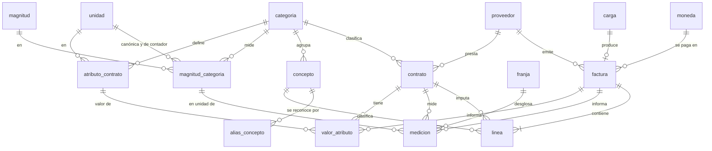
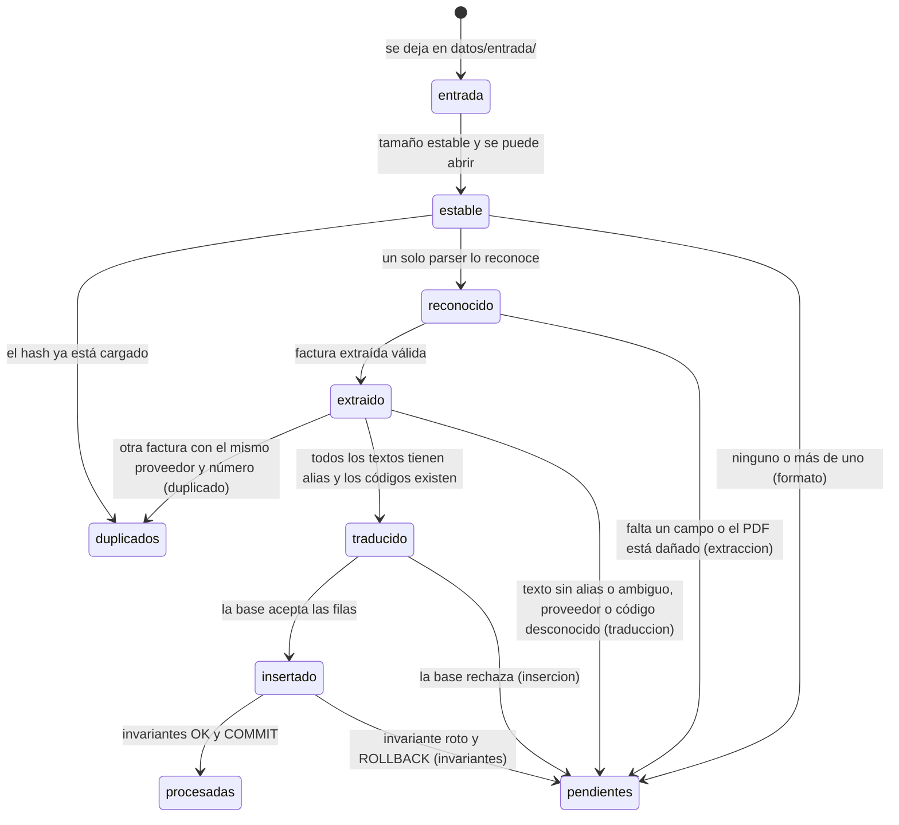

# Diseño de la base de datos

Diseño del bloque 1 de [`tarea.md`](../tarea.md) para el caso [`caso_hogar.md`](../caso_hogar.md): el modelo de datos, el contrato entre parsers y carga, el diccionario, el flujo de carga y la organización del código. Los bloques siguientes lo implementan.

Desde el bloque 2, el esquema SQL vive en `src/facturas/bd/esquema.sql` y las consultas de referencia en `src/facturas/bd/consultas/` (apéndices A y B). Este documento explica cada elemento; los cambios que hizo el bloque 2 sobre el diseño aprobado están en la sección 1.1.

## Índice

1. [Decisiones tomadas en el bloque 1](#1-decisiones-tomadas-en-el-bloque-1)
2. [Convención de nombres](#2-convención-de-nombres-r37)
3. [Modelo de datos](#3-modelo-de-datos)
4. [Números](#4-números-r11)
5. [Normalización](#5-normalización-r35)
6. [Índices](#6-índices-r38)
7. [Vistas](#7-vistas-r32-r36)
8. [Prorrateo](#8-prorrateo-r25)
9. [Cobertura](#9-cobertura-r26)
10. [Invariantes](#10-invariantes-r33)
11. [Contrato parser → carga](#11-contrato-parser--carga-factura-extraída)
12. [Diccionario inicial](#12-diccionario-inicial-r29-r31)
13. [Flujo de carga](#13-flujo-de-carga)
14. [Organización de `src/`](#14-organización-de-src)
15. [Consultas de referencia](#15-consultas-de-referencia)
16. [Ejemplo resuelto: `fibra_movil.pdf`](#16-ejemplo-resuelto-fibra_movilpdf)
17. [Verificación del diseño](#17-verificación-del-diseño)
18. [Trazabilidad de requisitos](#18-trazabilidad-de-requisitos-r1r43)

---

## 1. Decisiones tomadas en el bloque 1

Las aprobó la persona usuaria en la orientación del bloque. Las que se apartan de `tarea.md` o del caso figuran como desvíos en la [bitácora](../bitacora.md).

| # | Decisión | Por qué | Requisitos afectados |
|---|---|---|---|
| D1 | Cada línea guarda el texto impreso y el importe. No guarda cantidad, unidad, precio unitario, base imponible ni tipo impositivo. | El dashboard no los usa: el precio unitario efectivo sale del importe dividido por las mediciones. Simplifica el esquema, el contrato y los parsers. | Desvío en R2 (cantidad, unidad, precio), R4, R11 (precios y tipos), R12 y dos invariantes de R33 (cantidad × precio y base × tipo). |
| D2 | El canon del agua es una sola línea (el subtotal impreso, "CANON DEL AGUA"), con un único concepto `canon_agua`. | Lo pidió la persona usuaria. | Desvío respecto de la clasificación del caso, que separa la parte fija de la variable. |
| D3 | La tasa de alcantarillado también se toma de su subtotal impreso. | Sus tramos se imprimen con el mismo texto que los del canon ("Tramo hasta 15 m³"). Con el subtotal, cada texto identifica un solo concepto. | Desvío en R1: dos líneas impresas (el canon, D2, y el alcantarillado) se guardan como su subtotal. Si hay más consumo, el subtotal agrupa más tramos. |
| D4 | El diccionario traduce texto → concepto dentro de la categoría del contrato de la línea, con comodines para las partes variables. Un alias puede exigir además una sección del documento. Solo Digi la usa: "PRODUCTOS", "CONSUMO ADICIONAL"… (revisión H6). | El contrato separa lo que en Digi comparte factura (móvil y fibra). La sección evita que un cargo nuevo con un período entre paréntesis (un descuento, una penalización) se traduzca como cuota sin aviso. | — |
| D5 | Cada medición guarda solo su lectura de cierre (fecha, valor y si es real o estimada). | La lectura anterior es la de cierre de la factura previa del mismo contador. El consumo se guarda directamente y el tipo real o estimado del consumo es el de su lectura de cierre. | Desvío respecto de los valores esperados del caso, que listan las lecturas anteriores (agua 642, gas 15.547). |
| D6 | Prorrateo jerárquico (sección 8). | Garantiza que el total de cada contrato en cada mes quede a menos de 1 céntimo de su parte proporcional exacta, sea cual sea el número de líneas. Con un redondeo independiente por línea, los errores de las líneas se suman. Con los datos del caso coincide al céntimo con todos los controles; el redondeo por línea se desvía 1 céntimo en algunos meses del agua y del gas. | R25 (cumple). |
| D7 | El alias por defecto de un contrato ("movil 1") se numera en el orden de carga y no se persiste. Para que no choque con otro alias, se usa el menor número libre (sección 14.2). | Es un detalle cosmético; se revisa al final del proyecto. | Pendiente: con dos contratos de una misma categoría, una reconstrucción (R19) podría intercambiar sus números. |
| D8 | Un PDF distinto de una factura que ya está cargada (mismo proveedor y número) se rechaza como duplicado y se mueve a `datos/duplicados/`. | Puede pasar al juntar facturas de varios lugares. Nunca se reemplaza una factura sin avisar. Una factura cargada solo se reemplaza al reconstruir la base (R17, sección 13.4). | — |
| D9 | El hook de datos personales busca los patrones del caso y, además, los valores de una lista local fuera de git. Las semillas van en `src/facturas/semillas/`. | Nombres, direcciones y números de contrato no tienen un formato reconocible. Con las semillas dentro de `src/`, la estructura de `tarea.md` no cambia. | — |
| D10 | **Confirmada por la persona usuaria en el punto de control.** En el agua, el período impreso va de lectura a lectura y su primer día no se cuenta: se normaliza a inicio = fecha impresa + 1. El ejemplo queda del 2026-04-10 al 2026-06-08, 60 días (sección 11.7, revisión H1). | El PDF imprime "250 litros por día" (15.000 l / 60) y un "gasto medio de J,KZ €/día" (ZX,KK € / 60). Con 61 días serían 246 l y J,KQ €. Además, el período impreso coincide con las fechas de las dos lecturas, así que probablemente dos facturas consecutivas comparten la fecha de lectura. Si es así, con los dos extremos incluidos, el control de solapes rechazaría una de cada dos. La persona usuaria lo confirmó con la factura anterior a la del ejemplo, que termina el 09-abr-2026. | Era un error del caso, que daba por verificada la convención inclusiva en todos los formatos y usaba 61 días en los controles del agua. Con autorización de la persona usuaria, se corrigió `caso_hogar.md`. |

Otras decisiones menores, tomadas en este diseño:

- **Los hechos no se editan ni se borran sueltos.** Los triggers de la sección 3.4 rechazan cualquier `UPDATE` sobre facturas, líneas, mediciones y valores de atributo, y el `DELETE` de una línea, una medición o un valor de atributo si no es porque se borra su factura. Una factura cargada solo se reemplaza reconstruyendo la base (sección 13.4), que es como se cumple R17. Así ninguna regla puede saltearse modificando o borrando una fila después de insertarla. Queda abierto `INSERT OR REPLACE`, que saltea todos los triggers: SQLite no dispara los de borrado cuando un `REPLACE` borra la fila en conflicto. R17 lo prohíbe en el código, y el comando `estado` del bloque 4 verificará I1 en todas las facturas, para detectar una corrección manual así (revisiones del bloque 2, H4).
- **Se guarda la fecha de vencimiento** cuando el formato la imprime (Digi), porque figura entre los valores esperados del caso.
- **El calendario cubre de 2000-01-01 a 2099-12-31**, lo que lo hace independiente de los datos y de la fecha de construcción.
- **La reconstrucción "idéntica" de R19** se define en la sección 13.4.
- **Un cambio en las semillas reconstruye la base.** Por ejemplo, un alias que agrega el plan B. La base guarda la huella de las semillas con las que se construyó (tabla `construccion`), y la carga la compara antes de procesar (sección 13.2). Así la base nunca usa un diccionario distinto del versionado (revisión H7).
- **Correcciones de facturas.**
  - Una factura que una rectificativa por sustitución o un abono corrige deja de bloquear solapes, así que la refacturación de un período anulado se acepta (revisión H4).
  - Las sustituciones se controlan contra solapes igual que las ordinarias (revisión H16).
  - Una factura se puede sustituir una sola vez (revisión H8).
  - **Un abono anula entera la factura que corrige**, en todos sus contratos; un crédito parcial es una rectificativa por diferencias. El invariante I9 lo exige: el abono y su original suman 0 en cada contrato. La factura anulada y su abono no cuentan en ninguna vista, así que no aportan gasto, consumo ni atributos, traiga o no el abono su consumo, y la refacturación es la que cuenta (revisión del bloque 2, H1 y H7).

### 1.1 Cambios del bloque 2

Al implementar el diseño aparecieron estos cambios. Ninguno cambia el modelo.

| # | Cambio | Por qué |
|---|---|---|
| B1 | Los `CHECK` de fecha usan `col IS date(col)` en lugar de `col = date(col)`. `ck_carga_estado` exige además `etapa_rechazo IS NOT NULL` y `motivo_rechazo IS NOT NULL` en una carga rechazada. | **Error del diseño, que viene de R7.** `date()` devuelve NULL para un texto que no es una fecha ("23/06/2026"). Con `=`, el `CHECK` da NULL, y SQLite da por cumplido un `CHECK` que da NULL: la base aceptaba cualquier texto como fecha. Lo mismo pasaba con una carga rechazada sin etapa o sin motivo. Con `IS`, NULL solo pasa si la columna es nula, y `NOT NULL` lo impide donde corresponde. Lo detectaron los tests del bloque 2. |
| B2 | En `v_hecho_cobertura_contrato_mensual`, `dia_cubierto` se calcula desde los períodos cubiertos y no cruzando los días esperados con los períodos. | Mismo resultado (verificado con 10 años simulados) y más simple. El plan anterior recorría el calendario desde el año 2000 para cada contrato. C2 pasa de 0,79 a 0,53 s. |
| B3 | La huella de las semillas incluye el nombre y el tamaño de cada archivo, y normaliza los saltos de línea a LF. | git tiene `core.autocrlf = true`: el mismo archivo puede estar con CRLF o con LF según cómo se escribió o se sacó de git, y eso no debe forzar una reconstrucción. El nombre evita que mover una fila de un archivo a otro dé la misma huella. |
| B4 | La construcción no aplica los datos manuales: lo hace `aplicar_ajustes()`, que la carga llama al registrar contratos. | Una base recién construida no tiene contratos a los que aplicarlos. Es lo que ya decía la sección 13.4. |
| B5 | `normalizar()` y `traducir()` (`carga/traduccion.py`) se escribieron en el bloque 2. | El test de que ningún texto de los ejemplos es ambiguo (pendiente del bloque 1) tiene que usar el código real de la traducción. |
| B6 | Los alias del agua, el gas y la luz reconocen palabras clave y toleran cualquier detalle alrededor (sección 12.2). | Decisión de la persona usuaria en el punto de control: el dashboard responde "cuánto gasto en cada factura", y prefiere que un cambio menor en un rótulo no detenga la carga. Revierte la corrección del hallazgo H2 de la revisión del bloque 2, que exigía el rótulo completo. |


### 1.2 Ampliación del bloque 3

Dos facturas reales más movieron los parsers sin cambiar el modelo.

- **Digi, NIF anterior.** Las facturas de 2025 imprimen `B-84919760` (la razón social anterior, S.L.U.) y las de 2026, `A-84919760`. El parser reconoce los dos y emite siempre el vigente, así que todas las facturas de Digi comparten proveedor. Si se prefiriera tener dos proveedores, habría que agregar `B84919760` a `proveedor.csv`.
- **Digi, varias líneas móviles.** El bloque «EN EL MÓVIL» lista una línea por renglón (`importe €identificador`); el parser las lee todas. El IVA por servicio sumó lo impreso (H12) en el ejemplo de 2025, también con tres servicios.
- **Gas, ajuste parcial.** Un documento con la fila `Ajuste (<período>) s/ <factura>` es una `rectificativa_diferencias` de esa factura: vuelve a facturar el consumo con la lectura real y acredita el estimado, sin tocar el término fijo.
  - Las líneas son las impresas, con su signo; el total no tiene «a pagar», sino `Total <importe>`.
  - La medición es la **diferencia** de energía (kWh facturados menos acreditados, §11.5). La lectura de cierre es la nueva. La base exige los m³ y el factor en el gas, y el documento no imprime el neto en m³: se deriva (12 m³ de la lectura nueva menos los m³ acreditados, que salen de los kWh acreditados ÷ factor, enteros porque el contador lee m³ enteros). El parser verifica que reproduzcan los kWh acreditados.
  - Una lectura de tipo `Cliente` (la informó la persona usuaria) se guarda como `real`.
  - La original y su ajuste quedan vigentes y se suman: gasto neto y consumo reales (verificado con los dos PDFs y los invariantes, en cualquier orden de carga).
  - Limitación: C6 (consumo por tipo de lectura) muestra la original como estimada (344 kWh) y el ajuste como real (−206 kWh); el total del mes es el correcto (138 kWh).
  - La luz y el agua no tienen ejemplo de ajuste: sus parsers siguen rechazando todo lo que no sea una ordinaria.

### 1.3 Cambios del bloque 4

Al implementar la carga (parte A, C1 a C8) y los datos manuales y las copias de seguridad (parte B, C9 a C13) aparecieron estos cambios. Ninguno cambia el modelo.

| # | Cambio | Por qué |
|---|---|---|
| C1 | Tres módulos que no estaban en el árbol de la sección 14: `bd/volcado.py` (volcado canónico, sección 13.4), `operacion/reconstruccion.py` y `operacion/estado.py`. `proceso.py` define además `Rutas`, que dice dónde está cada carpeta a partir de la raíz. | El volcado lo usan la reconstrucción y, en la parte B, `restaurar`; no es lógica de ningún otro módulo. Reconstruir y mostrar el estado son responsabilidades distintas de procesar un PDF. |
| C2 | Una moneda desconocida se rechaza en la etapa `traduccion`, con «moneda no admitida: USD». | La sección 13.1 manda «código desconocido» a `traduccion` y la tabla de 13.3 la mandaba a `invariantes`. Se sigue el diagrama: es un código que el diccionario no tiene, como un proveedor o una franja, y el motivo es más claro que el de una FK rota. La tabla de 13.3 queda como estaba para la FK rota por un concepto de otra categoría (R9). |
| C3 | Más de 3 decimales en una cantidad, una lectura o un atributo se detecta en la carga (`milesimas()`) y se rechaza en la etapa `extraccion`. | `extraccion.py` solo comprueba el formato del decimal, no cuántos decimales tiene. Como el rechazo es de `extraccion`, la fila de `carga` queda sin la extracción (lo exige `ck_carga_extraccion_json`). |
| C4 | Al reconstruir, `carga.nombre_archivo` se toma de la base anterior por hash. Si la base no existe, queda el nombre de `procesadas/`. | `procesadas/` guarda los PDFs con nombre normalizado. Sin este paso, el nombre original cambiaría en cada reconstrucción y el volcado no sería idéntico (sección 13.4). Sin base anterior no hay de dónde recuperarlo. |
| C5 | El motivo de un rechazo se escribe en `<nombre del PDF sin extensión>.motivo.txt` (`agua.motivo.txt` junto a `agua.pdf`), con tres líneas: `Etapa:`, `Motivo:` y `Fecha:`. También acompaña a los PDFs de `duplicados/`. | `estado` y el plan B (bloque 6) lo leen. |
| C6 | El log va solo al archivo `datos/logs/facturas.log` (1 MB, 5 copias). El resumen y los errores los imprime el comando. | Con un manejador de consola se duplicaban los errores. |
| C7 | `estado` termina con código 2 si alguna factura no cumple I1. | Es lo que detecta un `INSERT OR REPLACE` manual (revisión H4): borra las líneas por la cascada y no dispara ningún trigger. |
| C8 | Los rechazos por solape se reintentan al final del lote **hasta que una vuelta no cargue ninguno**, y no una sola vez. | Observación `r10` de la revisión: con sustituciones encadenadas, cada factura cargada puede destrabar a otra. |
| C9 | `Rutas` agrega `config` (`datos/config.toml`, con `carpeta_respaldo = 'ruta'`). Sin ese archivo, `cargar` avisa («AVISO: no se hizo la copia de seguridad») y sigue. Con el archivo, si el respaldo falla (la carpeta no existe, Drive sin sincronizar…), la carga queda hecha y el comando sale con 2. `reprocesar --pendientes` también respalda si cargó algo; `reprocesar --todo` no. | R43 pide el respaldo después de cada carga, pero un proyecto recién copiado no tiene configuración y no tiene que fallar. Una carpeta configurada que no responde sí es un error, y el disparador (bloque 5) lo tiene que ver. |
| C10 | El respaldo hace `VACUUM INTO` desde una conexión `mode=ro` **sin** `query_only` (la sección 14.1 decía `query_only` para el respaldo). La instantánea se arma y se verifica (`integrity_check`) en una carpeta temporal local, `datos/respaldo_*`, y se copia a la carpeta de respaldo con el nombre provisional `….parcial`, que pasa a definitivo cuando el hash de la copia coincide con el original. | `query_only` también impide `VACUUM INTO`; `mode=ro` ya protege el archivo. Así SQLite nunca abre una base dentro de Google Drive, y Drive no sincroniza un archivo a medias con el nombre de una instantánea. |
| C11 | La carpeta de respaldo tiene `instantaneas/facturas_<marca>.db`, `instantaneas/ajustes_<marca>.json` (siempre: `[]` si no había datos manuales) y `procesadas/` con la misma estructura que la local. La marca es `AAAAMMDD_HHMMSS`; si ya existe, se avanza un segundo. | Es lo mínimo que necesita `restaurar` para encontrar los ajustes de la misma marca y los PDFs. |
| C12 | `restaurar` reutiliza `reemplazar_base` (era `_reemplazar` de la reconstrucción): la instantánea se copia a una carpeta local, se comprueba que se puede abrir (misma versión del esquema) y que pasa `integrity_check`, y reemplaza la base con la API de backup; el volcado canónico se compara contra la copia. Rechaza una instantánea dañada, de otra versión del esquema o sin sus ajustes, sin tocar nada. Si no hay base (equipo nuevo), la copia verificada pasa a ser la base. Avisa cuántos PDFs de `procesadas/` la instantánea no tiene. | Es el patrón de la sección 13.4 en sentido inverso. Una instantánea de otra versión no se abre con `conectar()`: se recupera con los PDFs y los ajustes, y `reprocesar --todo`. |
| C13 | `contrato` escribe en este orden: la base (transacción sin confirmar), el archivo de ajustes (reemplazo de una vez) y el `COMMIT`; si falla el archivo se revierte la base, y si falla el `COMMIT` el archivo vuelve a como estaba. Un cambio inválido (alias inexistente, vacío, repetido o reservado) sale con 2 y «No se cambió nada». Desde la versión 3 del esquema solo se cambia el alias (sección 1.4, E7): `--alta` y `--baja` ya no existen. | R41 pide «a la vez»; este orden deja los dos lados iguales ante cualquier fallo. |

### 1.4 Cambios de la etapa 4 del dashboard

La base guarda solo los hechos de las facturas: la interpretación (tipo de cargo, completitud de los meses) pasó a la capa semántica del dashboard (`semantica.toml`, `datos.cobertura_mensual`). Versión del esquema: 2 tras la etapa 4 y 3 tras quitar las fechas de `contrato` (E7).

| # | Cambio | Por qué |
|---|---|---|
| E1 | Se quitan la tabla `tipo_cargo`, `concepto.tipo_cargo_id` (con su índice), la vista `v_dim_tipo_cargo`, las columnas `tipo_cargo_*` de `v_dim_concepto`, `v_linea`, `v_hecho_gasto_diario` y `v_hecho_gasto_mensual`, y la semilla `tipo_cargo.csv` (y su columna en `concepto.csv`). | Clasificar un concepto como fijo, de consumo o de tasas es interpretar, no un hecho de la factura. El dashboard ya no lo leía. |
| E2 | Se quitan `v_hecho_cobertura_contrato_mensual` y `v_hecho_cobertura_categoria_mensual` (la sección 9 pasa a describir la regla del dashboard). | La cobertura es una regla del dashboard: por categoría, con cualquier contrato y sin fechas de alta ni de baja. |
| E3 | C3 se borra; C2 devuelve solo el gasto mensual por categoría; C4 agrupa por concepto; C5 recibe `:conceptos` (arreglo JSON de códigos) en lugar de `:tipo_cargo`. | Agrupar por tipo de cargo y marcar los meses incompletos ya no están en la base. |
| E4 | `estado` informa los meses incompletos con `dashboard.datos.cobertura_mensual`, por categoría y desde el primer hasta el último mes con gasto. Antes lo hacía por contrato, hasta el mes en curso y con las fechas de alta y baja. | Una sola regla de cobertura. `operacion` puede importar `dashboard`. |
| E5 | `docs/diccionario.md` lista los conceptos de cada categoría con su código, sin tipo de cargo. | Sin tipo de cargo en la base no hay qué listar. |
| E6 | **Desvío respecto del caso y de los requisitos, que no se modificaron** (`caso_hogar.md`, `requisitos.md`, `tests/caso.py`): el caso sigue clasificando los conceptos en «Tipos de cargo» y R2, R26, R29 y R36 nombran el tipo de cargo y la cobertura como parte de la base. Los tests dejaron de comparar el tipo de cargo con el caso; siguen comprobando que cada concepto del caso es uno de las semillas. | Orden de la etapa 4: esos archivos solo se tocan con autorización expresa. |
| E7 | Se quitan `contrato.fecha_alta`, `contrato.fecha_baja` y sus tres `CHECK`, las mismas columnas de `v_dim_contrato`, las opciones `--alta` y `--baja` de `contrato`, las columnas «alta» y «baja» de `contratos` y esos campos del formato de `ajustes_manuales.json` (un campo desconocido se rechaza al leerlo). El trigger de identidad de `contrato` solo deja modificar el alias. Versión del esquema: 3. Desvío respecto de `requisitos.md` (R41), `tarea.md` y `caso_hogar.md`, que no se modificaron. | Ya no las usaba nada desde la etapa 4 y el archivo de ajustes estaba vacío: no había datos que migrar. La base se reconstruyó con `reprocesar --todo`; las cifras no cambiaron (64 facturas, Q.JKQ,KZ €). |

---

## 2. Convención de nombres (R37)

Todo en español, en `snake_case`, sin tildes ni ñ. Se aplica sin excepciones en el esquema y en el código.

| Elemento | Regla | Ejemplo |
|---|---|---|
| Tabla | Sustantivo en singular. | `factura`, `linea`, `alias_concepto` |
| Clave primaria | `<tabla>_id`, `INTEGER PRIMARY KEY`. | `factura_id` |
| Clave foránea | El mismo nombre que la clave que referencia. Si hay más de una hacia la misma tabla, `<tabla>_<rol>_id`. | `contrato_id`; `unidad_canonica_id`, `unidad_contador_id` |
| Importe | Sufijo `_centimos` (entero). | `importe_centimos` |
| Cantidad física | Sufijo `_milesimas` (entero, milésimas de la unidad). | `cantidad_milesimas` |
| Fecha | Prefijo `fecha_`, texto `AAAA-MM-DD`. Fecha y hora: `fecha_hora`, texto `AAAA-MM-DD HH:MM:SS` en UTC. | `fecha_emision` |
| Indicador | Prefijo `es_`, entero 0 o 1. | `es_derivada` |
| Código estable | `codigo` (minúsculas, `[a-z0-9_]`); texto visible: `nombre`. | `categoria.codigo = 'agua'` |
| Restricción | `uq_<tabla>_<columnas>` (única), `ck_<tabla>_<regla>` (CHECK), `fk_<tabla>_<tabla referenciada>` (foránea compuesta). | `ck_factura_periodo` |
| Índice | `ix_<tabla>_<columnas>`; si es único, `ux_<tabla>_<columnas>`. | `ix_linea_contrato_id_categoria_id` |
| Trigger | `tg_<tabla>_<momento>_<regla>`, con momento `bi` (before insert), `bu` (before update) o `bd` (before delete). | `tg_linea_bi_solape` |
| Vista | `v_dim_<entidad>` (dimensión), `v_hecho_<proceso>_<grano>` (hecho) y `v_<nombre>` (auxiliar). | `v_hecho_gasto_mensual` |

Cómo aparecen estos nombres al diagnosticar un rechazo:

- **`CHECK` y triggers:** el nombre sale en el mensaje de error ("CHECK constraint failed: ck_linea_periodo"), así que el motivo de un rechazo dice qué regla falló.
- **`UNIQUE`:** SQLite nombra las columnas, no la restricción.
- **Claves foráneas:** SQLite solo dice "FOREIGN KEY constraint failed". Por eso la carga las difiere (`PRAGMA defer_foreign_keys = ON`) y las verifica con I7 antes del `COMMIT`: `PRAGMA foreign_key_check` devuelve la tabla, la fila y la clave foránea que falla, y el motivo nombra sus columnas (sección 10).

**Excepción de nombres:** SQLite crea el índice de cada restricción `UNIQUE` con un nombre propio (`sqlite_autoindex_<tabla>_<n>`), que es el que muestra `EXPLAIN QUERY PLAN`. La convención se aplica al nombre de la restricción (`uq_*`), con el que se citan en este documento. Declararlas como `CREATE UNIQUE INDEX` daría nombres propios a esos índices, pero las separaría de su tabla sin ganar nada más.

---

## 3. Modelo de datos

### 3.1 Diagrama entidad-relación



`calendario` y `construccion` no tienen relaciones declaradas. Las vistas cruzan el calendario por fecha, y `construccion` es una fila de metadatos.

Las tablas se dividen en dos grupos:

- **Diccionario y dimensiones** (semillas versionadas y calendario generado): `moneda`, `categoria`, `concepto`, `alias_concepto`, `unidad`, `magnitud`, `magnitud_categoria`, `franja`, `atributo_contrato`, `proveedor` y `calendario`. Se reconstruyen desde las semillas (R19). `construccion` registra con qué semillas se construyó la base.
- **Capa cruda** (lo que dicen los PDFs, R1): `carga`, `contrato`, `factura`, `linea`, `medicion` y `valor_atributo`. `contrato` es a la vez dato de los PDFs y dimensión; sus datos manuales vienen de `datos/ajustes_manuales.json` (R41).

Todas las tablas son `STRICT` y todas las columnas son `NOT NULL`, salvo las listadas como nulables, con su significado (R10).

### 3.2 Diccionario y dimensiones

#### `moneda`
Monedas admitidas (R42). La semilla del caso solo contiene `EUR`, así que una factura en otra moneda no encuentra fila y la clave foránea la rechaza.

| Columna | Tipo | Significado |
|---|---|---|
| `moneda_id` | INTEGER | Clave sustituta. |
| `codigo` | TEXT | Código ISO 4217. Natural, única. `CHECK`: tres letras mayúsculas. |

#### `categoria`
Categorías de gasto del caso: "¿cuánto gasté en X?".

| Columna | Tipo | Significado |
|---|---|---|
| `categoria_id` | INTEGER | Clave sustituta. |
| `codigo` | TEXT | Código estable (`agua`). Natural, única. `CHECK` de formato. |
| `nombre` | TEXT | Nombre visible. `CHECK` no vacío. |

#### `concepto`
Cargo normalizado. Pertenece a una categoría.

| Columna | Tipo | Significado |
|---|---|---|
| `concepto_id` | INTEGER | Clave sustituta. |
| `categoria_id` | INTEGER | FK → `categoria`. |
| `codigo` | TEXT | Código estable, único dentro de la categoría. |
| `nombre` | TEXT | Nombre visible. |
| `imputacion_defecto` | TEXT | `periodo` o `puntual`: cómo se imputan sus líneas, salvo que el documento indique otra cosa. |

- Clave natural: `UNIQUE (categoria_id, codigo)`, porque cada categoría tiene su propio IVA (`iva`).
- `UNIQUE (concepto_id, categoria_id)`: destino de las claves foráneas compuestas que hacen cumplir R9 (sección 3.3, `linea`).

#### `alias_concepto`
Patrones que traducen las líneas de los PDFs a un concepto (R29–R31).

| Columna | Tipo | Significado |
|---|---|---|
| `alias_concepto_id` | INTEGER | Clave sustituta. |
| `categoria_id` | INTEGER | Categoría donde rige el alias; es la del concepto. |
| `concepto_id` | INTEGER | Concepto al que traduce. |
| `patron_seccion` | TEXT | Patrón `GLOB` sobre la sección normalizada de la línea (sección 12.3). `*`: cualquier sección; `''` (vacío): solo líneas sin sección. |
| `patron_texto` | TEXT | Patrón `GLOB` sobre el texto normalizado de la línea. |

- Clave natural: `UNIQUE (categoria_id, patron_seccion, patron_texto)`.
- FK compuesta `(concepto_id, categoria_id)` → `concepto`: el alias solo puede traducir a un concepto de su misma categoría.
- `CHECK`: los dos patrones están normalizados (minúsculas, ASCII imprimible, sin espacios dobles ni en los extremos).

#### `unidad`
Unidades de las mediciones y de los atributos de contrato: `unidad_id`, `codigo` (natural, única, `m3`), `simbolo` (visible, `m³`).

#### `magnitud`
Magnitudes medidas: `magnitud_id`, `codigo` (natural, única, `energia`), `nombre`.

#### `magnitud_categoria`
Qué magnitud se mide en cada categoría, en qué unidad canónica (R13) y en qué unidad lee el contador.

| Columna | Tipo | Significado |
|---|---|---|
| `magnitud_categoria_id` | INTEGER | Clave sustituta. |
| `categoria_id` | INTEGER | FK → `categoria`. |
| `magnitud_id` | INTEGER | FK → `magnitud`. |
| `unidad_canonica_id` | INTEGER | FK → `unidad`. Unidad en la que se guardan las cantidades (gas: kWh). |
| `unidad_contador_id` | INTEGER | FK → `unidad`. Unidad de las lecturas y de la cantidad en unidad de contador (gas: m³). |

- Clave natural: `UNIQUE (categoria_id, magnitud_id)`.
- `UNIQUE (magnitud_categoria_id, categoria_id)`: destino de la FK compuesta desde `medicion`.

#### `franja`
Franjas horarias: `franja_id`, `codigo` (natural, única, `punta`), `nombre`.

#### `atributo_contrato`
Atributos de contrato que determinan el coste (R22), por categoría.

| Columna | Tipo | Significado |
|---|---|---|
| `atributo_contrato_id` | INTEGER | Clave sustituta. |
| `categoria_id` | INTEGER | FK → `categoria`. |
| `unidad_id` | INTEGER | FK → `unidad`. |
| `codigo` | TEXT | Código estable (`potencia_p1`), único dentro de la categoría. |
| `nombre` | TEXT | Nombre visible. |

- `UNIQUE (atributo_contrato_id, categoria_id)`: destino de la FK compuesta desde `valor_atributo`.

#### `proveedor`
Empresas emisoras, identificadas por su identificador fiscal (R20).

| Columna | Tipo | Significado |
|---|---|---|
| `proveedor_id` | INTEGER | Clave sustituta. |
| `identificador_fiscal` | TEXT | Normalizado: solo `[A-Z0-9]` (`CHECK`). Natural, única. El parser lo normaliza con la regla del caso: mayúsculas, sin guiones ni espacios. |
| `nombre` | TEXT | Razón social. |

#### `calendario`
Un registro por día, de 2000-01-01 a 2099-12-31 (R24).

| Columna | Tipo | Significado |
|---|---|---|
| `calendario_id` | INTEGER | La fecha como entero `AAAAMMDD`. Es la clave de fecha que recomienda Kimball: entera, ordenable y legible. `CHECK`: coincide con `fecha`. |
| `fecha` | TEXT | `AAAA-MM-DD`. Única. |
| `anio`, `mes`, `dia` | INTEGER | Partes de la fecha. |
| `anio_mes` | TEXT | `AAAA-MM`: la clave de mes de las vistas mensuales. |
| `dias_mes` | INTEGER | Días del mes. |

Un `CHECK` exige que todas las columnas derivadas sean coherentes con `fecha`. Así una fila del calendario no puede contradecirse.

#### `construccion`
Una sola fila (`CHECK construccion_id = 1`) que dice con qué semillas se construyó la base (R29, R40; revisión H7).

| Columna | Tipo | Significado |
|---|---|---|
| `construccion_id` | INTEGER | Siempre 1. |
| `huella_semillas` | TEXT | SHA-256, en hexadecimal, de los archivos de `src/facturas/semillas/` en orden de nombre: de cada uno, el nombre, el tamaño y el contenido con los saltos de línea normalizados a LF (sección 1.1, B3). |

No guarda cuándo se construyó la base: dos reconstrucciones con las mismas semillas y los mismos PDFs tienen que dar el mismo contenido (R19, revisión H18).

`PRAGMA user_version` versiona el esquema y `huella_semillas`, el diccionario. Si la huella guardada difiere de la de los archivos, la carga reconstruye la base antes de procesar (sección 13.2). Un test (`test_cada_cambio_del_esquema_sube_su_version`) guarda la huella de `esquema.sql` de cada versión, así que un cambio del esquema sin subir la versión no pasa los tests (revisión del bloque 2, H3).

### 3.3 Capa cruda

#### `carga`
Un registro por PDF procesado, identificado por su hash (R14). Permite rastrear cualquier número hasta su PDF (R15) y reprocesar sin volver a leerlo.

| Columna | Tipo | Nulo | Significado |
|---|---|---|---|
| `carga_id` | INTEGER | | Clave sustituta. |
| `sha256` | TEXT | | Hash SHA-256 del PDF, en hexadecimal y minúsculas. Natural, única. |
| `nombre_archivo` | TEXT | | Nombre original del archivo. |
| `formato` | TEXT | sí | Formato del parser que lo reconoció. Nulo: ningún parser lo reconoció (rechazo en la etapa `formato`). |
| `version_parser` | TEXT | sí | Versión de ese parser. Nula si y solo si `formato` es nulo. |
| `fecha_hora` | TEXT | | Último intento, en UTC. |
| `estado` | TEXT | | `cargada` o `rechazada`. |
| `etapa_rechazo` | TEXT | sí | `formato`, `extraccion`, `traduccion`, `duplicado`, `insercion` o `invariantes`. Nula si y solo si está cargada. |
| `motivo_rechazo` | TEXT | sí | Texto legible, con el dato concreto (por ejemplo, el texto sin alias). Nulo si y solo si está cargada. |
| `extraccion_json` | TEXT | sí | Salida cruda del parser (sección 11), JSON válido. Nula: el rechazo fue anterior a la extracción (`formato` o `extraccion`). Obligatoria si está cargada. |

Los `CHECK` `ck_carga_estado`, `ck_carga_formato` y `ck_carga_extraccion_json` hacen cumplir esas equivalencias (revisión H19):
- `formato` es nulo si y solo si el rechazo fue en la etapa `formato`;
- `extraccion_json` es nula si y solo si fue en `formato` o `extraccion`.

 Un PDF rechazado que se reintenta (por ejemplo, tras una corrección del plan B) actualiza su fila (`INSERT … ON CONFLICT (sha256) DO UPDATE`), de modo que `carga_id` se mantiene. El trigger `tg_carga_bu_cargada` impide modificar una carga que ya produjo una factura: no puede pasar a `rechazada` mientras su factura sigue en la base (revisión H10).

#### `contrato`
Lo que se paga de forma recurrente a un proveedor. Se registra solo la primera vez que aparece (R21).

| Columna | Tipo | Nulo | Significado |
|---|---|---|---|
| `contrato_id` | INTEGER | | Clave sustituta. |
| `proveedor_id` | INTEGER | | FK → `proveedor`. |
| `categoria_id` | INTEGER | | FK → `categoria`. La informa el parser, que la conoce por el formato. |
| `identificador_externo` | TEXT | | Código del proveedor (CUPS, nº de contrato, nº de línea o identificador de fibra, según el formato). Solo vive en la base; el dashboard no lo ve. |
| `alias` | TEXT | | Nombre visible. Por defecto, `<categoría> <n>` (D7); se cambia con el comando `contrato` (R41). Único. |

- Clave natural: `UNIQUE (proveedor_id, identificador_externo)`.
- `UNIQUE (contrato_id, categoria_id)`: destino de las FK compuestas (R9).

Es la única tabla cruda que se modifica (`UPDATE`), y solo en los datos manuales: `tg_contrato_bu_identidad` rechaza cambiar el proveedor, la categoría o el identificador externo.

#### `factura`
Cabecera de una factura (R1).

| Columna | Tipo | Nulo | Significado |
|---|---|---|---|
| `factura_id` | INTEGER | | Clave sustituta. |
| `carga_id` | INTEGER | | FK → `carga`. Única: una carga produce como mucho una factura (R15). |
| `proveedor_id` | INTEGER | | FK → `proveedor`. |
| `moneda_id` | INTEGER | | FK → `moneda` (R42). |
| `numero` | TEXT | | Número de factura impreso. |
| `tipo` | TEXT | | `ordinaria`, `rectificativa_sustitucion`, `rectificativa_diferencias` o `abono` (R27). |
| `numero_factura_corregida` | TEXT | sí | Número de la factura que corrige, del mismo proveedor. Nulo si y solo si es ordinaria. |
| `fecha_emision` | TEXT | | Fecha de emisión. |
| `fecha_vencimiento` | TEXT | sí | Nula: el formato no imprime vencimiento. |
| `fecha_inicio`, `fecha_fin` | TEXT | | Período facturado, con los dos extremos incluidos. El parser lo normaliza según la convención de su formato (R23, sección 11.7). |
| `importe_total_centimos` | INTEGER | | Total a pagar impreso. |

- Clave natural: `UNIQUE (proveedor_id, numero)` (R16).
- `ux_factura_proveedor_id_numero_factura_corregida_sustitucion`, índice único parcial sobre `(proveedor_id, numero_factura_corregida)` con `WHERE tipo = 'rectificativa_sustitucion'`: una factura se sustituye como mucho una vez. Una cadena (R2 sustituye a R1, que sustituyó a F1) sigue siendo posible, porque cada una referencia un número distinto (revisión H8).
- `CHECK`: fechas ISO (`col IS date(col)`, sección 1.1, B1), inicio ≤ fin, `tipo` válido, y número corregido presente si y solo si no es ordinaria, no vacío y sin espacios en los extremos.

La factura corregida se referencia por su número y no por una clave foránea. Las facturas históricas pueden cargarse en cualquier orden, y una rectificativa puede llegar antes que la factura que corrige. La vista `v_factura_vigente` resuelve la referencia por `(proveedor_id, numero)`. Los invariantes se calculan sobre todas las facturas, vigentes o no, así que la original se carga igual aunque llegue después (revisión H3).

#### `linea`
Un cargo de una factura: una fila por línea, tal como viene en el documento (R1, R2).

| Columna | Tipo | Nulo | Significado |
|---|---|---|---|
| `linea_id` | INTEGER | | Clave sustituta. |
| `factura_id` | INTEGER | | FK → `factura`, `ON DELETE CASCADE`. |
| `posicion` | INTEGER | | Orden en el documento, desde 1. |
| `contrato_id` | INTEGER | | Contrato al que se imputa. |
| `categoria_id` | INTEGER | | Categoría del contrato y del concepto (ver R9 abajo). |
| `concepto_id` | INTEGER | | Concepto traducido por el diccionario. |
| `texto` | TEXT | | Texto literal del PDF (solo recortado). |
| `importe_centimos` | INTEGER | | Importe impreso (R12). Puede ser negativo (abonos, descuentos). |
| `imputacion` | TEXT | | `periodo` o `puntual`. Es la del concepto, salvo que el documento indique otra (sección 11). |
| `fecha_inicio`, `fecha_fin` | TEXT | | Período de la línea para el prorrateo: el de la factura, salvo que el documento indique otro (R23). Los solapes y la cobertura del dashboard usan el período de la factura (sección 9). |
| `es_derivada` | INTEGER | | 1 si el parser la calculó repartiendo un total impreso (R5); 0 si está impresa tal cual. |

La sección del documento que acompaña a la línea en la factura extraída (sección 11.4) sirve solo para traducirla y queda en `carga.extraccion_json`. No se guarda en `linea`, porque ninguna consulta la usa.

- Clave natural: `UNIQUE (factura_id, posicion)`. No incluye importes (R16).
- **R9:** `fk_linea_contrato` `(contrato_id, categoria_id)` → `contrato` y `fk_linea_concepto` `(concepto_id, categoria_id)` → `concepto`. Como la misma columna `categoria_id` participa en las dos claves foráneas, la base exige que el concepto sea de la categoría del contrato. Es una regla declarativa, sin triggers.
- `CHECK`: fechas ISO e inicio ≤ fin, valores permitidos de `imputacion` y de `es_derivada`.
- Triggers: `tg_linea_bi_solape` (R28) y `tg_linea_bu_inmutable`.

#### `medicion`
Consumo físico informado en la factura, por contrato, magnitud y franja (R3, R13).

| Columna | Tipo | Nulo | Significado |
|---|---|---|---|
| `medicion_id` | INTEGER | | Clave sustituta. |
| `factura_id` | INTEGER | | FK → `factura`, `ON DELETE CASCADE`. |
| `contrato_id`, `categoria_id` | INTEGER | | FK compuesta → `contrato`. |
| `magnitud_categoria_id` | INTEGER | | FK compuesta `(magnitud_categoria_id, categoria_id)` → `magnitud_categoria`: la magnitud tiene que estar definida para la categoría del contrato. |
| `franja_id` | INTEGER | sí | FK → `franja`. Nula: la factura no desglosa esta medición por franja. |
| `cantidad_milesimas` | INTEGER | | Cantidad en la unidad canónica de la magnitud. |
| `cantidad_contador_milesimas` | INTEGER | sí | La misma cantidad en la unidad del contador (gas: 30 m³). Nula: el documento la informa solo en la unidad canónica. |
| `factor_conversion` | TEXT | sí | Factor impreso, en decimal exacto (gas: `11.470` kWh/m³). Nulo si y solo si la columna anterior lo es. |
| `fecha_lectura` | TEXT | | Fecha de la lectura de cierre. |
| `lectura_milesimas` | INTEGER | | Valor de la lectura de cierre, en la unidad del contador. |
| `tipo_lectura` | TEXT | | `real` o `estimada`. Es también el tipo del consumo (D5). |

- Clave natural: `ux_medicion_factura_contrato_magnitud_franja` sobre `(factura_id, contrato_id, magnitud_categoria_id, ifnull(franja_id, 0))`. El índice usa la expresión porque en un `UNIQUE` SQLite trata los nulos como distintos entre sí, y `0` nunca es un id válido.
- `tg_medicion_bi_franja`: para una misma factura, contrato y magnitud, o hay una medición sin franja o hay mediciones por franja, nunca las dos. Si el documento desglosa por franja, su total impreso no se guarda como medición: duplicaría el consumo (revisión H5).
- `tg_medicion_bi_conversion`: si el contador de la categoría mide en una unidad distinta de la canónica (gas: m³ frente a kWh), la cantidad en unidad del contador y el factor son obligatorios (revisión H14). El factor tiene que ser mayor que 0.
- Una cantidad puede ser negativa: en una ordinaria, es una regularización (la lectura real quedó por debajo de una estimada anterior); en una rectificativa por diferencias, es la diferencia. Las mediciones de un abono y de la factura que anula no cuentan (sección 7.2) (revisión del bloque 2, H9).
- La unidad no se repite en cada fila: sale de `magnitud_categoria` (R35).

#### `valor_atributo`
Valor de un atributo de contrato según una factura (R22). Rige durante el período de esa factura: esa es su fecha de vigencia.

| Columna | Tipo | Significado |
|---|---|---|
| `valor_atributo_id` | INTEGER | Clave sustituta. |
| `factura_id` | INTEGER | FK → `factura`, `ON DELETE CASCADE`. |
| `contrato_id`, `categoria_id` | INTEGER | FK compuesta → `contrato`. |
| `atributo_contrato_id` | INTEGER | FK compuesta `(atributo_contrato_id, categoria_id)` → `atributo_contrato`. |
| `valor_milesimas` | INTEGER | Valor en milésimas de la unidad del atributo (4,4 kW → 4400). |

- Clave natural: `UNIQUE (factura_id, contrato_id, atributo_contrato_id)`.

La vigencia se guarda por factura, y no como "vigente desde" con fechas que se van cerrando. Así no depende del orden en que se cargan las facturas, y cada valor se puede rastrear hasta su PDF. La vista `v_dim_contrato_atributo` junta las facturas consecutivas con el mismo valor en tramos de vigencia.

### 3.4 Triggers

| Trigger | Regla | Requisito |
|---|---|---|
| `tg_linea_bi_solape` | Antes de insertar una línea con imputación `periodo` de una factura ordinaria o de una rectificativa por sustitución, rechaza si el mismo contrato tiene una línea `periodo` de otra factura de esos tipos cuyo período se superpone. Compara los períodos de las facturas: los huecos no se rechazan. No cuentan las facturas, la nueva o la existente, que una rectificativa por sustitución o un abono del mismo proveedor corrige. Así una sustitución no choca con la factura que sustituye y se puede refacturar un período anulado (revisiones H4 y H16). | R28 |
| `tg_medicion_bi_franja` | Rechaza mezclar una medición sin franja con mediciones por franja de la misma factura, contrato y magnitud. | R3, R13 |
| `tg_medicion_bi_conversion` | Rechaza una medición sin cantidad en unidad del contador cuando esa unidad difiere de la canónica. | R10, R13 |
| `tg_factura_bi_carga` | Rechaza una factura cuya carga no está `cargada`. | R15 |
| `tg_carga_bu_cargada` | Rechaza modificar una carga que produjo una factura. | R15 |
| `tg_factura_bu_inmutable`, `tg_linea_bu_inmutable`, `tg_medicion_bu_inmutable`, `tg_valor_atributo_bu_inmutable` | Rechazan cualquier `UPDATE`. Una factura se reemplaza entera. | R6, R17 |
| `tg_linea_bd_suelta`, `tg_medicion_bd_suelta`, `tg_valor_atributo_bd_suelta` | Rechazan el `DELETE` de una fila cuya factura sigue en la base. Borrar la factura las borra en cascada: cuando la cascada llega a ellas, la factura ya no existe. | R6, R17 |
| `tg_contrato_bu_identidad` | Rechaza cambiar el proveedor, la categoría o el identificador externo de un contrato. | R21, R41 |

Las demás reglas son declarativas (`CHECK`, `UNIQUE`, claves foráneas compuestas). Por eso no hacen falta triggers de `UPDATE` para R9 ni R28: no hay `UPDATE` posible.

Lo que no se declara en la base, y queda a cargo del parser (bloque 3): qué categorías desglosan el consumo por franja (hoy, solo la luz). Una medición de gas con franja sería un error del parser; declararlo en la base pediría una marca por categoría en `magnitud_categoria` y otro trigger, y ningún caso lo justifica hoy (revisión del bloque 2, H5).

**Qué cubre y qué no el control de solapes:**
- Las sustituciones se controlan contra las demás ordinarias y sustituciones vigentes del contrato, no contra la factura que sustituyen. Una sustitución que alarga el período, o una ordinaria que pisa el período de una factura ya sustituida, se rechazan (revisión H16).
- Las rectificativas por diferencias y los abonos no se controlan: corrigen importes de un período ya facturado.
- Un abono anula entera la factura que corrige (I9), así que la refacturación del mismo período no choca con ella. Un crédito parcial no es un abono sino una rectificativa por diferencias, y no libera el período (revisión del bloque 2, H7).

---

## 4. Números (R11)

| Qué | Cómo se guarda | Por qué |
|---|---|---|
| Importes | `INTEGER` en céntimos (`*_centimos`). | Exactos y sumables. `STRICT` rechaza decimales y texto. |
| Cantidades físicas: mediciones, lecturas, atributos | `INTEGER` en milésimas de su unidad (`*_milesimas`). | Se suman y se prorratean con el mismo algoritmo que los importes. Los ejemplos tienen como mucho 3 decimales (4,400 kW). Un valor con más decimales no se trunca: hace fallar la carga en la etapa `extraccion`. |
| Factor de conversión | `TEXT` con el decimal exacto impreso (`11.470`). `CHECK` de formato y mayor que 0. | Nunca se suma ni se prorratea: solo se muestra. Se guarda sin perder ningún decimal. |
| Precios unitarios y tipos impositivos | No se guardan (D1). | — |

El parser devuelve los decimales como texto (`"4.400"`), nunca como números de coma flotante. La carga los convierte a milésimas sin pasar por `float`.

---

## 5. Normalización (R35)

Cada atributo depende de la clave, de toda la clave y de nada más que la clave, salvo las excepciones justificadas abajo.

| Tabla | Forma normal | Comentario |
|---|---|---|
| `moneda`, `categoria`, `unidad`, `magnitud`, `franja`, `proveedor` | 3FN | Código y nombre dependen solo del id. |
| `concepto` | 3FN | Categoría e imputación por defecto dependen del concepto. |
| `alias_concepto` | 2FN, con desnormalización controlada | `categoria_id` depende de `concepto_id` (dependencia transitiva). Se guarda para declarar la unicidad de los patrones dentro de la categoría. La FK compuesta impide que difiera de la del concepto, así que no hay anomalía de actualización. |
| `magnitud_categoria`, `atributo_contrato` | 3FN | — |
| `construccion` | 3FN | Una sola fila de metadatos. |
| `calendario` | Desnormalizada a propósito | `anio`, `mes`, `dia`, `anio_mes` y `dias_mes` dependen de `fecha`. Es una dimensión de fechas: la redundancia evita recalcular en cada consulta, y un `CHECK` impide que se contradiga. |
| `carga` | 3FN | `formato` y `version_parser` describen el proceso que leyó el PDF; no hay una tabla de formatos porque ninguna otra tabla se relaciona con ellos. |
| `contrato` | 3FN | — |
| `factura` | 3FN | `numero_factura_corregida` es una referencia por clave natural (sección 3.3), no un dato repetido. |
| `linea` | 2FN, con desnormalización controlada | `categoria_id` depende de `contrato_id`. Es la columna que permite declarar R9 con claves foráneas, y las dos FK compuestas garantizan que coincide con la del contrato y con la del concepto. `imputacion`, `fecha_inicio` y `fecha_fin` no dependen de otras columnas: pueden diferir de las del concepto y de la factura cuando el documento lo indica, así que son hechos de la línea. |
| `medicion`, `valor_atributo` | 2FN, con desnormalización controlada | El mismo `categoria_id`, por la misma razón (coherencia magnitud o atributo ↔ categoría del contrato). |

La desnormalización para leer (nombres, códigos, días del período) se hace en las vistas.

---

## 6. Índices (R38)

### 6.1 Claves foráneas

Cada clave foránea tiene un índice que empieza por sus columnas: SQLite lo usa al borrar o modificar la fila referenciada, y en los joins.

| Clave foránea | Índice que la cubre |
|---|---|
| `concepto.categoria_id` | `uq_concepto_categoria_codigo` |
| `alias_concepto (concepto_id, categoria_id)` | `ix_alias_concepto_concepto_id_categoria_id` |
| `magnitud_categoria.categoria_id` | `uq_magnitud_categoria_categoria_magnitud` |
| `magnitud_categoria.magnitud_id` | `ix_magnitud_categoria_magnitud_id` |
| `magnitud_categoria.unidad_canonica_id`, `.unidad_contador_id` | `ix_magnitud_categoria_unidad_canonica_id`, `ix_magnitud_categoria_unidad_contador_id` |
| `atributo_contrato.categoria_id` | `uq_atributo_contrato_categoria_codigo` |
| `atributo_contrato.unidad_id` | `ix_atributo_contrato_unidad_id` |
| `contrato.proveedor_id` | `uq_contrato_proveedor_identificador_externo` |
| `contrato.categoria_id` | `ix_contrato_categoria_id` |
| `factura.carga_id` | `uq_factura_carga` |
| `factura.proveedor_id` | `uq_factura_proveedor_numero` |
| `factura.moneda_id` | `ix_factura_moneda_id` |
| `linea.factura_id` | `uq_linea_factura_posicion` |
| `linea (contrato_id, categoria_id)` | `ix_linea_contrato_id_categoria_id` |
| `linea (concepto_id, categoria_id)` | `ix_linea_concepto_id_categoria_id` |
| `medicion.factura_id` | `ux_medicion_factura_contrato_magnitud_franja` |
| `medicion (contrato_id, categoria_id)` | `ix_medicion_contrato_id_categoria_id` |
| `medicion (magnitud_categoria_id, categoria_id)` | `ix_medicion_magnitud_categoria_id_categoria_id` |
| `medicion.franja_id` | `ix_medicion_franja_id` |
| `valor_atributo.factura_id` | `uq_valor_atributo_factura_contrato_atributo` |
| `valor_atributo (contrato_id, categoria_id)` | `ix_valor_atributo_contrato_id_categoria_id` |
| `valor_atributo (atributo_contrato_id, categoria_id)` | `ix_valor_atributo_atributo_contrato_id_categoria_id` |

### 6.2 Consultas

| Índice | Consulta que lo usa |
|---|---|
| `ix_factura_proveedor_id_numero_factura_corregida` | `v_factura_vigente`, `tg_linea_bi_solape`, I6 e I9: ¿una rectificativa por sustitución o un abono corrige esta factura? En las vistas se evalúa una vez por factura. |
| `ux_factura_proveedor_id_numero_factura_corregida_sustitucion` | No sirve a una consulta, sino a una regla: una sola sustitución por factura (H8). Es parcial, así que solo incluye las rectificativas por sustitución y no reemplaza al índice anterior, que cubre también los abonos. |
| `ix_linea_contrato_id_categoria_id` | `tg_linea_bi_solape`: líneas del mismo contrato. |
| `uq_calendario_fecha` | Prorrateo y cobertura del dashboard: los días entre `fecha_inicio` y `fecha_fin` de cada línea (búsqueda por rango). |
| `uq_carga_sha256` | Carga: ¿ya se procesó este PDF? |
| `uq_factura_proveedor_numero` | Carga: ¿ya existe esta factura? (D8). |
| `uq_contrato_proveedor_identificador_externo` | Carga: ¿el contrato ya está registrado? |
| `uq_alias_concepto_categoria_patrones` | Traducción: los alias de la categoría del contrato. |
| `ux_medicion_factura_contrato_magnitud_franja` | `tg_medicion_bi_franja`: mediciones de la misma factura, contrato y magnitud. |

### 6.3 Recorridos completos que quedan

Lo verifica `tests/test_indices.py` sobre la implementación:

- **Cómo se detecta un recorrido completo:** en el bytecode de cada sentencia (`EXPLAIN`), un cursor que se abre sobre una tabla o uno de sus índices y se rebobina al principio. `EXPLAIN QUERY PLAN` muestra los alias de las vistas, que se repiten (`c` es `contrato` en una vista y `calendario` en otra), así que no sirve para un test.
- **Qué se verifica:**
  - cada clave foránea tiene un índice no parcial que empieza por sus columnas;
  - las consultas de referencia y los invariantes recorren enteras solo `linea` y `medicion`;
  - los cuerpos de los triggers y las búsquedas de la carga no recorren ninguna tabla: buscan por índice.

**Por qué se recorren enteras `linea` y `medicion`.** El prorrateo jerárquico necesita todas las líneas de cada grupo (factura × contrato × período) para calcular sus acumulados con funciones de ventana, y el filtro por mes solo se puede aplicar después, porque `anio_mes` sale del prorrateo. El invariante I4 filtra por factura, pero SQLite no lleva ese filtro dentro de una vista que une (`UNION ALL`) consultas con funciones de ventana, así que también calcula el prorrateo de todas. `factura` y las tablas del diccionario se buscan por clave primaria.

**Rendimiento.** Medido con `tests/rendimiento.py`: 10 años simulados, con 360 facturas y 2.280 líneas, en SQLite 3.49.1.

| Consulta | Tiempo |
|---|---|
| C1–C5 | 0,45–0,66 s según la corrida; el revisor midió cerca de 1 s en C4 y C5 |
| C6, C7 | 0,08–0,11 s |
| Invariantes de una factura (I4 es casi todo) | 0,29–0,31 s |

Con los 2 años del caso es una fracción de eso, y reconstruir 10 años llevaría alrededor de un minuto. Si algún día no alcanzara, la solución sería materializar el prorrateo en una tabla regenerada en cada carga; hoy no hace falta.

---

## 7. Vistas (R32, R36)

El dashboard lee solo vistas, con una conexión de solo lectura (R39).

En todas las vistas, `importe_centimos` significa lo mismo: el importe de la línea tal como está impreso, en céntimos. Los impuestos son líneas propias (concepto `iva` y otros), así que sumar todas las líneas da el total pagado en todas las categorías. En Digi, las líneas impresas no incluyen el IVA y el IVA son líneas derivadas; en el agua, las líneas tampoco lo incluyen y el IVA es una línea impresa. Por eso el resultado es el mismo en ambas.

### 7.1 Dimensiones

| Vista | Grano | Columnas |
|---|---|---|
| `v_dim_fecha` | Un día | `calendario_id`, `fecha`, `anio`, `mes`, `dia`, `anio_mes`, `dias_mes` |
| `v_dim_categoria` | Una categoría | `categoria_id`, `categoria_codigo`, `categoria_nombre` |
| `v_dim_concepto` | Un concepto | `concepto_id`, `concepto_codigo`, `concepto_nombre`, `categoria_id`, `categoria_codigo`, `imputacion_defecto` |
| `v_dim_proveedor` | Un proveedor | `proveedor_id`, `identificador_fiscal`, `proveedor_nombre` |
| `v_dim_contrato` | Un contrato | `contrato_id`, `alias`, `categoria_id`, `categoria_codigo`, `proveedor_id`, `proveedor_nombre`. Sin el identificador externo (R21). |
| `v_dim_contrato_atributo` | Un tramo de vigencia de un atributo de un contrato | `contrato_id`, `atributo_codigo`, `atributo_nombre`, `unidad`, `valor_milesimas`, `vigente_desde`, `vigente_hasta` (R22) |

### 7.2 Auxiliares

| Vista | Grano | Columnas |
|---|---|---|
| `v_factura_vigente` | Una factura que cuenta (R27): se excluyen las que una `rectificativa_sustitucion` o un `abono` del mismo proveedor referencia por su número, y los abonos | `factura_id`, `carga_id`, `proveedor_id`, `numero`, `tipo`, `numero_factura_corregida`, `moneda`, `fecha_emision`, `fecha_vencimiento`, `fecha_inicio`, `fecha_fin`, `importe_total_centimos` |
| `v_linea` | Una línea de una factura vigente | `linea_id`, `factura_id`, `posicion`, `proveedor_id`, `fecha_emision`, `contrato_id`, `categoria_id`, `categoria_codigo`, `concepto_id`, `concepto_codigo`, `concepto_nombre`, `texto`, `importe_centimos`, `imputacion`, `fecha_inicio`, `fecha_fin`, `dias`, `es_derivada` |
| `v_prorrateo_linea` | Línea × día, de **todas** las facturas, vigentes o no (sección 8) | `linea_id`, `factura_id`, `calendario_id`, `fecha`, `anio_mes`, `importe_centimos` |
| `v_prorrateo_medicion` | Medición × día, de todas las facturas | `medicion_id`, `factura_id`, `calendario_id`, `fecha`, `anio_mes`, `cantidad_milesimas` |

Las rectificativas por diferencias siguen vigentes junto con la factura que corrigen: sus importes y sus mediciones se suman. Un abono, en cambio, anula entera la factura que corrige (I9): ni el abono ni la factura anulada son vigentes. Si llega primero el abono, tampoco cuenta, y su original no contará cuando llegue (revisión del bloque 2, H7).

Las dos vistas de prorrateo no filtran la vigencia. Las usan el invariante I4, que tiene que poder verificar una factura ya sustituida (revisión H3), y las vistas de hechos, que sí filtran las vigentes.

### 7.3 Hechos

| Vista | Grano | Medida | Columnas de contexto |
|---|---|---|---|
| `v_hecho_gasto_diario` | Línea × día. Una línea `periodo` tiene una fila por día de su período; una `puntual`, una sola fila en la fecha de emisión. | `importe_centimos` | `calendario_id`, `fecha`, `anio_mes`, `linea_id`, `factura_id`, `contrato_id`, categoría y concepto (id y código; el concepto, también con nombre) |
| `v_hecho_gasto_mensual` | Mes × contrato × concepto. El concepto determina la categoría; se incluye el contrato para separar, por ejemplo, dos líneas móviles. | `importe_centimos` | `anio_mes`, `contrato_id`, categoría y concepto |
| `v_hecho_consumo_diario` | Medición × día | `cantidad_milesimas` (unidad canónica) | `fecha`, `anio_mes`, `medicion_id`, `factura_id`, `contrato_id`, categoría, `magnitud_codigo`, `unidad`, `franja_codigo` (`sin_franja` si no hay franja), `tipo_lectura` |
| `v_hecho_consumo_mensual` | Mes × contrato × magnitud × franja × tipo de lectura | `cantidad_milesimas` | Las mismas, sin día |

---

## 8. Prorrateo (R25)

### 8.1 Regla

- Las líneas `puntual` van enteras a la fecha de emisión.
- Las líneas `periodo` se reparten por días, en céntimos y por **grupos**: las líneas de una misma factura, del mismo contrato y con el mismo período, ordenadas por posición.

Sea un grupo con N días y líneas de importes I₁…Iₘ:

- Sᵢ = I₁ + … + Iᵢ es el acumulado del grupo hasta la línea i (S₀ = 0).
- R(x) es x redondeado al entero más cercano; las mitades se alejan del cero.
- Lo asignado a la línea i desde el primer día hasta el día k (k = 1…N) es

  **Aᵢ(k) = R(Sᵢ·k / N) − R(Sᵢ₋₁·k / N)**

- El importe de la línea i en el día k es Aᵢ(k) − Aᵢ(k − 1), con Aᵢ(0) = 0.

Propiedades:

1. **Exacto por línea:** Aᵢ(N) = R(Sᵢ) − R(Sᵢ₋₁) = Iᵢ, porque los acumulados son enteros. La suma de los días de una línea es exactamente su importe, y lo mismo vale para la suma de sus meses.
2. **Exacto por grupo:** la suma de todas las líneas hasta el día k es R(Sₘ·k / N). El total del contrato en la factura se reparte por días con un único redondeo acumulado, así que cada mes se aparta menos de 1 céntimo de su parte proporcional exacta. Por eso coincide con los controles del caso.
3. **Determinista y en SQL puro:** solo usa sumas acumuladas (`sum() OVER`), aritmética entera y `lag()`. Está en `v_prorrateo_linea`, sin tablas intermedias (R1); `v_hecho_gasto_diario` le agrega las dimensiones y el filtro de vigencia.

El redondeo independiente por línea, Iᵢ·k/N redondeado línea por línea, también es exacto por línea. Pero sus errores, de hasta medio céntimo por línea y mes, se suman entre las líneas de un contrato. Con los ejemplos del caso se desvía 1 céntimo de los controles en algunos meses del agua y del gas, mientras que el jerárquico coincide exactamente. Por eso se prefiere el jerárquico (D6).

**Contrapartida:** cuando una línea reparte menos de 1 céntimo por día, algún día puede recibir −1 céntimo, compensado otro día. La suma de la línea sigue siendo exacta, y el desvío de un mes respecto de su parte proporcional es de menos de 2 céntimos. No ocurre en los ejemplos, ni en una simulación de 10 años con sus importes.

**Mediciones.** Se reparten con el mismo algoritmo, en milésimas de su unidad canónica. El período es el de la factura y los grupos son las mediciones de una factura, contrato y magnitud, ordenadas por franja.

### 8.2 Ejemplo numérico: el móvil de `fibra_movil.pdf`

Con los importes ficticios de `tests/datos_prueba.py` (los reales no se versionan). Período del 2026-07-15 al 2026-08-14: N = 31 días, 17 en julio (k = 1…17) y 14 en agosto.

| i | Línea | Iᵢ | Sᵢ | Julio: Aᵢ(17) = R(Sᵢ·17/31) − R(Sᵢ₋₁·17/31) | Agosto: Iᵢ − julio |
|---|---|---|---|---|---|
| 1 | Cuota del plan | 615 | 615 | R(337,26) − 0 = 337 | 278 |
| 2 | Llamadas incluidas | 0 | 615 | 337 − 337 = 0 | 0 |
| 3 | SMS | 7 | 622 | R(341,10) − 337 = 341 − 337 = 4 | 3 |
| 4 | IVA (derivada) | 131 | 753 | R(412,94) − 341 = 413 − 341 = 72 | 59 |
| | **Total** | **753** | | **413** (control: 4,13) | **340** (control: 3,40) |

Por día, por ejemplo para el IVA (i = 4): el día 1 recibe R(753/31) − R(622/31) = 24 − 20 = 4. Hasta el día 2 lleva R(1506/31) − R(1244/31) = 49 − 40 = 9, así que el día 2 recibe 5.

---

## 9. Cobertura (R26)

Desde la etapa 4 del dashboard la cobertura no está en la base: es una regla del dashboard, `datos.cobertura_mensual`, que lee `v_linea`, `v_factura_vigente` y `v_dim_fecha`. La usan el Overview (los meses incompletos) y `estado`.

1. **Períodos cubiertos:** el período de cada factura vigente que tiene al menos una línea `periodo` de la categoría, con cualquier contrato. Se usa el período de la factura y no el de cada línea, para que una línea con período propio (una regularización de meses anteriores) no haga parecer cubiertos meses cuya factura falta (revisión H11). Las rectificativas por diferencias no cubren días: corrigen un período ya facturado. Un abono anula entera la factura que corrige: ni uno ni otra son vigentes, así que sus días quedan sin cubrir hasta que llega la refacturación.
2. **Días cubiertos de un mes:** los días distintos del mes que caen dentro de algún período cubierto, así que dos facturas que cubren el mismo día no lo cuentan dos veces. Una factura con solo líneas `puntual` no cubre días.
3. **Completo:** todos los días del mes están cubiertos.
4. **Sin fechas de alta ni de baja** y sin mes en curso: el dashboard pide el rango de meses (el del gasto) y la función devuelve una fila por categoría y mes, aunque no haya facturas. Con varios servicios, el mes está completo si lo está para todos (`semantica.meses_completos`). Los meses incompletos se marcan; no se excluyen de ninguna vista de gasto.

---

## 10. Invariantes (R33)

Los verifica la carga dentro de su transacción, antes del `COMMIT`, sobre la factura que está cargando. Si alguno falla, revierte la transacción y la carga se rechaza en la etapa `invariantes`, con la lista de violaciones en el motivo. El bloque 2 los implementa como una función `verificar(conexion, factura_id) → lista de violaciones`.

| # | Invariante | Fórmula | Tolerancia |
|---|---|---|---|
| I1 | Las líneas suman el total | Σ `linea.importe_centimos` de la factura = `factura.importe_total_centimos` | 0 céntimos |
| I2 | Cantidad × precio ≈ importe | No aplica: no se guardan cantidades ni precios en las líneas (D1). | — |
| I3 | Base × tipo ≈ cuota | No aplica: no se guardan bases ni tipos (D1). | — |
| I4 | El prorrateo suma el importe | Por línea: Σ `v_prorrateo_linea.importe_centimos` = `linea.importe_centimos`. Por medición: Σ `v_prorrateo_medicion.cantidad_milesimas` = `medicion.cantidad_milesimas`. Las vistas de prorrateo no filtran la vigencia, así que una factura ya sustituida también se verifica (revisión H3). | 0 |
| I5 | Concepto coherente con la categoría del contrato | `linea.categoria_id` = `contrato.categoria_id` = `concepto.categoria_id` | 0 violaciones |
| I6 | Sin solapes | Ninguna otra factura ordinaria o rectificativa por sustitución del mismo contrato con líneas `periodo` cuyo período se superponga. Es la misma condición que `tg_linea_bi_solape`, incluidas las excepciones por sustitución y abono (sección 3.4). | 0 violaciones |
| I7 | Integridad referencial | `PRAGMA foreign_key_check` devuelve vacío. Las FK se difieren en la transacción de carga (`PRAGMA defer_foreign_keys = ON`), así que una violación llega hasta acá. Cada fila que devuelve el pragma (tabla, fila, padre, id de FK) se traduce con `PRAGMA foreign_key_list` a las columnas de la FK, y el motivo dice, por ejemplo, "linea → contrato (contrato_id, categoria_id)" (revisión H13). | 0 filas |
| I8 | Líneas derivadas (R5) | Por cada total repartido de la factura extraída: Σ importes de sus líneas derivadas = total impreso | 10 céntimos (desde el 2026-10-06; antes, 0) |
| I9 | Un abono anula entera la factura que corrige (R27) | Si el abono y la factura que corrige están los dos en la base, sus líneas suman 0 en cada contrato. Se verifica al cargar cualquiera de los dos, así que no depende del orden. No es uno de los invariantes de R33: hace cumplir la definición de abono (sección 1; revisión del bloque 2, H7). | 0 céntimos |

- **Por qué la tolerancia es siempre 0:** todos los invariantes comparan enteros entre sí, sin productos ni redondeos de por medio.
- **I5, I6 e I7 los garantiza también la base:** las claves foráneas compuestas, el trigger y las FK con `PRAGMA foreign_keys = ON` impiden esas situaciones; si se colaran, el `COMMIT` las rechazaría. Se verifican igual, como red de seguridad (por ejemplo, si una conexión se abriera sin claves foráneas) y para que el motivo del rechazo sea legible.
- **I8 compara las líneas de la base con la extracción:** la base no guarda el total impreso que se reparte, solo la marca `es_derivada`; el total queda en `carga.extraccion_json`. Una línea derivada lleva como texto el rótulo de su total (sección 11.4), así que I8 suma las líneas derivadas de la base con ese texto y compara con cada total de `totales_repartidos`. También señala una línea derivada cuyo texto no es el de ningún total. El parser ya lo verifica (bloque 3), y la carga lo vuelve a comprobar.
- **Si los totales por servicio de Digi no suman el IVA impreso**, por ejemplo por un redondeo de 1 céntimo (revisión H12): ocurrió en la factura de jul 2025 (Q,KK € derivados, J,XJ € impresos). La persona usuaria decidió (2026-10-06) que I8 admita hasta 10 céntimos de diferencia (`extraccion.TOLERANCIA_REPARTO_CENTIMOS`). Las líneas se guardan como salen de los totales por servicio impresos y siguen sumando exactamente el total de la factura (I1).

---

## 11. Contrato parser → carga ("factura extraída")

Es lo único que se pasan los parsers y la carga.

- **El parser** solo conoce el PDF. Devuelve los textos tal como aparecen en el documento y no sabe nada de la base ni del diccionario.
- **La carga** solo conoce esta estructura. Traduce los textos a conceptos y escribe en la base.
- **Formato:** se serializa como JSON y se guarda en `carga.extraccion_json`.

**Convenciones de formato:**
- Fechas: texto `AAAA-MM-DD`.
- Importes: enteros en céntimos.
- Decimales: texto con punto decimal y sin separador de miles (`"4.400"`), para no perder ningún decimal (R11).
- Textos: literales, solo recortados.

### 11.1 Cabecera

| Campo | Tipo | Obligatorio | Significado y formato |
|---|---|---|---|
| `formato` | texto | sí | Código del parser (`digi_convergente`). |
| `version_parser` | texto | sí | Versión del parser. |
| `identificador_fiscal` | texto | sí | Del proveedor, normalizado con la regla del caso: solo `[A-Z0-9]`. |
| `numero` | texto | sí | Número de factura. |
| `tipo` | texto | sí | `ordinaria`, `rectificativa_sustitucion`, `rectificativa_diferencias` o `abono`. |
| `numero_factura_corregida` | texto o null | sí, si `tipo` ≠ `ordinaria` | Null en las ordinarias. |
| `moneda` | texto | sí | ISO 4217. |
| `fecha_emision` | fecha | sí | |
| `fecha_vencimiento` | fecha o null | no | Null: el formato no la imprime (ver 11.6). |
| `periodo` | `{inicio, fin}` | sí | Período facturado, con los dos extremos incluidos. El parser aplica la convención de su formato (R23, sección 11.7) y verifica el número de días contra el documento cuando lo imprime. |
| `importe_total_centimos` | entero | sí | Total a pagar impreso (en el agua, "TOTAL A PAGAR"). |

### 11.2 Contratos (lista, al menos uno)

| Campo | Tipo | Obligatorio | Significado |
|---|---|---|---|
| `identificador_externo` | texto | sí | Identificador del contrato en este formato (el caso indica cuál). |
| `categoria` | texto | sí | Código de categoría: el parser la conoce por el formato. |
| `atributos` | lista de `{atributo, valor}` | sí (puede estar vacía) | Código del atributo (`potencia_p1`) y valor decimal en su unidad (`"4.400"`). |

### 11.3 Totales repartidos (lista, puede estar vacía)

Totales impresos que el parser reparte entre contratos (R5).

| Campo | Tipo | Significado |
|---|---|---|
| `texto` | texto | Rótulo del total impreso (`IMPUESTOS (21.00% IVA)`). Único dentro de la factura. |
| `importe_centimos` | entero | Total impreso. |

### 11.4 Líneas (lista, al menos una, en orden del documento)

| Campo | Tipo | Obligatorio | Significado |
|---|---|---|---|
| `posicion` | entero | sí | 1, 2, 3… en orden del documento. |
| `contrato` | texto | sí | `identificador_externo` de uno de los contratos de la factura. |
| `seccion` | texto o null | no | Rótulo literal del bloque del documento en el que aparece la línea (Digi: `PRODUCTOS`, `CONSUMO INCLUIDO EN EL PLAN`, `CONSUMO ADICIONAL`). Null: la línea no está dentro de un bloque rotulado. Lo usa la traducción (sección 12.3). |
| `texto` | texto | sí | Texto literal. En una línea derivada, el rótulo del total repartido. |
| `importe_centimos` | entero | sí | Importe impreso, o el calculado si es derivada. |
| `periodo` | `{inicio, fin}` o null | no | Null: el de la factura. |
| `imputacion` | `periodo`, `puntual` o null | no | Null: la del concepto. El parser solo la informa si el documento indica, por ejemplo, un cargo de una sola fecha. |
| `derivada_de` | texto o null | no | `texto` del total repartido del que sale. Null: impresa tal cual. |

### 11.5 Mediciones (lista, puede estar vacía)

| Campo | Tipo | Obligatorio | Significado |
|---|---|---|---|
| `contrato` | texto | sí | `identificador_externo`. |
| `magnitud` | texto | sí | Código de magnitud (`energia`). |
| `franja` | texto o null | no | Código de franja. Null: sin desglose. Si el documento desglosa por franja, se emite una medición por franja y no el total (`tg_medicion_bi_franja`). |
| `cantidad` | decimal | sí | En la unidad canónica de la magnitud para la categoría (gas: kWh). |
| `cantidad_contador` | decimal o null | no | En la unidad del contador, si el documento la informa (gas: `"30"` m³). |
| `factor_conversion` | decimal o null | no | Obligatorio si y solo si hay `cantidad_contador`. |
| `lectura` | `{fecha, valor, tipo}` | sí | Lectura de cierre: fecha, valor decimal en la unidad del contador y tipo (`real` o `estimada`). |

**Signo de las cantidades** (revisión del bloque 2, H7 y H9). El parser emite las cantidades como las imprime el documento. Una cantidad negativa en una ordinaria es una regularización: la lectura real quedó por debajo de una estimada anterior. En una rectificativa por diferencias, es la diferencia. Las mediciones de un abono no cuentan, porque el abono y la factura que anula no son vigentes (sección 7.2).

### 11.6 Validaciones de forma

Se aplican al construir la estructura. Si alguna falla, el rechazo queda en la etapa `extraccion`:

- campos obligatorios presentes;
- fechas válidas;
- decimales con el formato del contrato;
- posiciones 1…n sin huecos;
- cada línea y cada medición referencia un contrato declarado;
- cada `derivada_de` referencia un total repartido;
- la suma de las líneas derivadas de cada total es igual a ese total (I8);
- no se mezclan mediciones con y sin franja para el mismo contrato y magnitud;
- los campos opcionales que el formato imprime están presentes (ver abajo).

Un campo obligatorio que el parser no encuentra hace fallar la extracción con un error que nombra el campo y el formato. Nunca se completa con un valor por defecto (R10).

**Campos opcionales por formato (revisión H14).** Un campo opcional es nulo solo porque el formato no lo imprime, nunca porque no se encontró. Cada parser declara qué campos opcionales imprime su formato, y para ese formato son obligatorios:

| Formato | Campos opcionales que imprime |
|---|---|
| `aigues_agua` | — |
| `naturgy_gas` | `cantidad_contador` y `factor_conversion` de la medición |
| `naturgy_luz` | `franja` de las mediciones; atributos `potencia_p1` y `potencia_p2` |
| `digi_convergente` | `fecha_vencimiento`; `seccion` de las líneas impresas |

Para el gas, además, `tg_medicion_bi_conversion` lo exige en la base.

### 11.7 Período de cada formato (R23)

El parser devuelve siempre el período con los dos extremos incluidos. Así se obtiene cada extremo en cada formato, y así se verificó:

| Formato | Qué imprime | Período normalizado | Verificación |
|---|---|---|---|
| `aigues_agua` | "Periodo de facturación 09-abr-26 / 08-jun-26": las fechas de las lecturas anterior y actual | **D10:** inicio = fecha impresa + 1; fin = fecha impresa. El ejemplo queda del 2026-04-10 al 2026-06-08, 60 días. | Los tres promedios impresos corresponden a 60 días, no a 61: "250 litros por día" (15.000 l / 60), "J,KZ €/día" (ZX,KK € / 60) y "J,JK €/día" de suministro (JK,ZZ € / 60). El período impreso coincide con las fechas de las lecturas, y la factura anterior a la del ejemplo termina el 09-abr-2026: dos facturas consecutivas comparten ese día. El parser verifica los días de cada factura con esos promedios impresos. La primera factura de un contrato no tiene anterior y cuenta también el día del alta: los promedios impresos deciden entre los dos casos (2026-10-06). |
| `naturgy_gas` | "del 30/04/2026 al 25/06/2026" y "57 días" en el término fijo | Las fechas impresas. | 57 = fin − inicio + 1. La lectura "desde" es del 29/04, el día anterior al inicio: la misma lógica que la propuesta para el agua. |
| `naturgy_luz` | "del 27/05/2026 al 28/06/2026" y "33 días" en la potencia | Las fechas impresas. | 33 = fin − inicio + 1. |
| `digi_convergente` | "15/07/2026 - 14/08/2026" | Las fechas impresas. | No imprime días. Los períodos son mensuales, del día 15 al 14, así que el siguiente empieza el 15/08. El bloque 3 lo confirma con dos facturas consecutivas del histórico. |
| `naturgy_iberia_luz`, `naturgy_iberia_gas` (2024) | "Electricidad: del 02.10.2024 al 02.11.2024" y "32 días" a la izquierda del detalle | Las fechas impresas. | 32 = fin − inicio + 1. La luz siguiente (Naturgy Clientes) empieza el día después del fin. Añadido el 2026-10-06. |

---

## 12. Diccionario inicial (R29–R31)

### 12.1 Conceptos

Todos con imputación por defecto `periodo`.

| Categoría | Código | Nombre |
|---|---|---|
| agua | `cuota_servicio` | Cuota del servicio |
| agua | `consumo_agua` | Consumo de agua |
| agua | `canon_agua` | Canon del agua (D2) |
| agua | `alcantarillado` | Tasa de alcantarillado |
| agua | `residuos_municipales` | Tasa de recogida de residuos municipales |
| agua | `tmtr` | Tasa metropolitana de tratamiento de residuos |
| agua | `iva` | IVA |
| gas | `consumo_gas` | Consumo de gas |
| gas | `termino_fijo` | Término fijo |
| gas | `impuesto_hidrocarburos` | Impuesto especial sobre hidrocarburos |
| gas | `iva` | IVA |
| luz | `consumo_electricidad` | Consumo de electricidad |
| luz | `potencia_p1` | Término de potencia P1 |
| luz | `potencia_p2` | Término de potencia P2 |
| luz | `bono_social` | Financiación del bono social |
| luz | `alquiler_contador` | Alquiler de contador |
| luz | `impuesto_electricidad` | Impuesto sobre la electricidad |
| luz | `iva` | IVA |
| fibra | `cuota_fibra` | Cuota de fibra |
| fibra | `iva` | IVA |
| movil | `cuota_plan` | Cuota del plan |
| movil | `consumo_incluido` | Consumo incluido en el plan |
| movil | `consumo_adicional` | Consumo adicional |
| movil | `iva` | IVA |

### 12.2 Alias: los textos de los PDFs de ejemplo

Patrón de sección `*`: cualquier sección, o ninguna. Patrón vacío (`''`): solo líneas sin sección.

**Criterio de los patrones (decisión de la persona usuaria en el punto de control del bloque 2).** En el agua, el gas y la luz, cada patrón reconoce las palabras clave del concepto y tolera cualquier detalle alrededor. Así, un cambio menor en el rótulo ("CANON DEL AGUA (*)", "Término fijo (57 días)", el rótulo de la página 1 en lugar del de la página 2) no detiene la carga. Un cargo de otra naturaleza, sin ninguna palabra clave conocida ("Recargo por demora", "Alta del suministro"), sigue rechazándose (R30), y el plan B propone su concepto. La contrapartida: un texto con una palabra clave que en realidad es otra cosa ("Devolución canon del agua 2025") se clasifica en ese concepto. El total de la factura, y por lo tanto el de la categoría, no cambia; a lo sumo, cambia el concepto o el mes de ese importe dentro del desglose. El objetivo del dashboard es "cuánto gasto en cada factura", así que se prefiere esto a detener la carga. En Digi, los alias ya se apoyan en la sección del documento.

| Categoría | Patrón de sección | Patrón de texto | Concepto | Línea del ejemplo que reconoce |
|---|---|---|---|---|
| agua | `*` | `*cuota*servicio*` | `cuota_servicio` | Cuota del servicio |
| agua | `*` | `tramo*` | `consumo_agua` | Tramo hasta 12 m³ · Tramo de 12 a 15 m³ |
| agua | `*` | `*canon*` | `canon_agua` | CANON DEL AGUA(\*) |
| agua | `*` | `iva*` | `iva` | IVA del 10% de la base sujeta |
| agua | `*` | `*alcantarillado*` | `alcantarillado` | TASA DE ALCANTARILLADO (Ayuntamiento de Barcelona …) |
| agua | `*` | `*residuos*domicilios*` | `residuos_municipales` | TASA DE RECOGIDA RESIDUOS MUNICIPALES GENERADOS EN LOS DOMICILIOS |
| agua | `*` | `*tratamiento*residuos*` | `tmtr` | TASA METROPOLITANA TRATAMIENTO RESIDUOS MUNICIPALES (T.M.T.R.) |
| gas | `*` | `*consumo*` | `consumo_gas` | Consumo gas |
| gas | `*` | `*termino fijo*` | `termino_fijo` | Término fijo |
| gas | `*` | `*hidrocarburos*` | `impuesto_hidrocarburos` | Impuesto Especial sobre hidrocarburos |
| gas | `*` | `iva*` | `iva` | IVA (21%) |
| luz | `*` | `*consumo*` | `consumo_electricidad` | Consumo electricidad |
| luz | `*` | `*potencia*p1*` | `potencia_p1` | Término potencia P1 |
| luz | `*` | `*potencia*p2*` | `potencia_p2` | Término potencia P2 |
| luz | `*` | `*bono social*` | `bono_social` | Financiación de Bono Social |
| luz | `*` | `*alquiler*` | `alquiler_contador` | Alquiler de contador (bloque "Otros conceptos") |
| luz | `*` | `*impuesto*electric*` | `impuesto_electricidad` | Impuesto electricidad |
| luz | `*` | `iva*` | `iva` | IVA (21%) |
| fibra | `productos` | `* (* - *)` | `cuota_fibra` | PRODUCTOS · Fibra PRO-DIGI 10 Gb (15 Jul - 14 Ago) |
| fibra | `''` | `impuestos (*% iva)` | `iva` | IMPUESTOS (21.00% IVA), derivada |
| movil | `productos` | `* (* - *)` | `cuota_plan` | PRODUCTOS · 100 GB + Ilimitadas (15 Jul - 14 Ago) |
| movil | `consumo incluido en el plan` | `*` | `consumo_incluido` | CONSUMO INCLUIDO EN EL PLAN · Llamadas incluidas en tu producto |
| movil | `consumo adicional` | `*` | `consumo_adicional` | CONSUMO ADICIONAL · SMS |
| movil | `''` | `impuestos (*% iva)` | `iva` | IMPUESTOS (21.00% IVA), derivada |

En el agua, el parser no emite como líneas los subtotales "SUMINISTRO DE AGUA" ni "TOTAL FACTURA", ni los tramos del canon y del alcantarillado (D2, D3). En Digi, los rótulos de sección se imprimen subrayados con guiones bajos intercalados ("P__R_O__D__U_C__T_O__S"); el parser los limpia antes de devolverlos.

### 12.3 Normalización y comparación (R30)

1. **Normalizar la sección y el texto de la línea:** Unicode NFKD, quitar las marcas diacríticas, pasar a minúsculas y colapsar los espacios. Una sección nula se normaliza como vacía (`''`). Por ejemplo, "Tramo de 12 a 15 m³" queda "tramo de 12 a 15 m3", porque NFKD convierte "³" en "3".
2. **Buscar en la categoría del contrato** los alias que cumplan `seccion_normalizada GLOB patron_seccion AND texto_normalizado GLOB patron_texto`. `GLOB` distingue mayúsculas, lo que no afecta porque los dos lados están en minúsculas. `*` reemplaza cualquier secuencia y `?`, un carácter; un `[` literal se escribe `[[]`.
3. **Resolver según cuántos coincidan:**
   - Uno: ese es el concepto.
   - Ninguno: la factura se rechaza en la etapa `traduccion`, con la sección, el texto y la categoría en el motivo. Nunca se descarta ni se asigna a un concepto genérico.
   - Más de uno: se rechaza como texto ambiguo, con los alias en conflicto. Un test de las semillas (bloque 2) comprueba que ningún texto de los ejemplos es ambiguo.

### 12.4 Partes variables (R31)

Las partes que cambian con el tiempo se cubren con comodines en el patrón, así que no generan conceptos ni alias nuevos.

| Dónde (según el caso) | Parte variable | Cómo se resuelve |
|---|---|---|
| Agua: tramos de consumo | Umbrales ("hasta 12 m³", "de 12 a 15 m³") | `tramo*` |
| Agua, gas y luz: IVA | Tipo impositivo (10%, 21%; el IVA de la energía tuvo rebajas temporales) | `iva*` |
| Agua, gas y luz: el resto de los rótulos | Detalles del rótulo: organismo, notas, días, años | Palabras clave del concepto, con `*` alrededor (sección 12.2) |
| Digi: productos | Nombre comercial y período entre paréntesis | Sección `productos` y texto `* (* - *)`. La categoría del contrato separa la cuota del móvil de la de la fibra. |
| Digi: consumos | Tipo de consumo (llamadas, datos, SMS, roaming) | La sección: `consumo incluido en el plan` o `consumo adicional`, con texto `*`, como sugiere el caso. |
| Digi: IVA derivado | Tipo impositivo | `impuestos (*% iva)`, sin sección |

Con la sección, un cargo nuevo de Digi fuera de esos bloques se rechaza en lugar de traducirse como cuota: un descuento, una penalización o un alquiler en otro bloque (revisión H6, probado en la sección 17).

**Riesgo residual:** una línea nueva dentro del bloque PRODUCTOS que lleve un período entre paréntesis se traduciría como cuota. Se revisará con las facturas históricas de Digi.

### 12.5 Formato de las semillas

Archivos CSV en `src/facturas/semillas/`: UTF-8, separados por comas, con encabezado y una fila por registro. Se referencian por códigos, nunca por ids. La construcción de la base (bloque 2) los carga en este orden:

| Archivo | Columnas |
|---|---|
| `moneda.csv` | `codigo` |
| `categoria.csv` | `codigo,nombre` |
| `concepto.csv` | `categoria,codigo,nombre,imputacion_defecto` |
| `alias_concepto.csv` | `categoria,concepto,patron_seccion,patron_texto` |
| `unidad.csv` | `codigo,simbolo` |
| `magnitud.csv` | `codigo,nombre` |
| `magnitud_categoria.csv` | `categoria,magnitud,unidad_canonica,unidad_contador` |
| `franja.csv` | `codigo,nombre` |
| `atributo_contrato.csv` | `categoria,codigo,nombre,unidad` |
| `proveedor.csv` | `identificador_fiscal,nombre` (ya creado: el hook de datos personales lo usa como lista de permitidos) |

Valores del caso para las tablas que no son conceptos ni alias:

- **Unidades:** `m3` (m³), `kwh` (kWh) y `kw` (kW).
- **Magnitudes:** `volumen` y `energia`.
- **Magnitud por categoría** (canónica / contador): agua, volumen en m³ / m³; gas, energía en kWh / m³; luz, energía en kWh / kWh.
- **Franjas:** `punta`, `llano` y `valle`.
- **Atributos:** luz, `potencia_p1` y `potencia_p2`, en kW.

`docs/diccionario.md` se genera desde la base (bloque 2): por categoría, cada concepto con su código.

---

## 13. Flujo de carga

El bloque 4 lo implementa.

### 13.1 Estados de un PDF



### 13.2 Pasos y registro

**Antes del lote:**

- **Semillas al día.** La carga compara la huella de los archivos de semillas con `construccion.huella_semillas`. Si difieren (por ejemplo, porque se aprobó un alias nuevo del plan B), primero reconstruye la base (sección 13.4) y después procesa. Así un `reprocesar --pendientes` tras aprobar un alias encuentra el alias en la base (revisión H7). Si la reconstrucción falla, el lote no procesa nada y termina con error del sistema (código 2). Nunca carga con un diccionario distinto del versionado (revisión H15).
- **Orden.** Se extraen todos los PDFs del lote y se cargan por fecha de emisión y, a igual fecha, por ruta. Así una factura original suele cargarse antes que su rectificativa o su abono, y un abono antes que la refacturación del mismo período.

**Por cada PDF:**

1. **Copia estable.** El tamaño no cambia durante unos segundos y el archivo se puede abrir.
2. **Hash.** Se calcula el SHA-256.
   - Si `carga` tiene ese hash con estado `cargada`, el PDF va a `datos/duplicados/` y la base no cambia; solo se anota en el log.
   - Si lo tiene como `rechazada`, es un reintento: sigue el proceso y actualiza esa fila.
3. **Reconocimiento.** Se pregunta a todos los parsers registrados si reconocen el documento.
4. **Extracción.** Se construye y valida la factura extraída (sección 11.6).
5. **Duplicado de factura (D8).** Si ya existe una factura con ese proveedor y número, se rechaza en la etapa `duplicado`. Una factura cargada nunca se reemplaza en la carga normal; solo al reconstruir (sección 13.4, revisión H10).
6. **Transacción** (`BEGIN IMMEDIATE`, R18), con `PRAGMA defer_foreign_keys = ON` para que I7 nombre la clave foránea que falle (sección 10):
   1. Se registra la carga con el upsert de la sección 3.3.
   2. Se insertan la cabecera, los contratos nuevos (R21) con sus ajustes manuales si los hay (R41), las líneas traducidas, las mediciones y los valores de atributo. Los ids se obtienen con `RETURNING` o por clave natural, nunca con `lastrowid` (R17).
   3. Se verifican los invariantes (sección 10).
   4. Se hace `COMMIT`.
7. **Éxito.** El PDF se mueve a `datos/procesadas/<categorías>/<año>/<inicio>_<fin>_<formato>_<número>.pdf`:
   - `<categorías>`: los códigos de las categorías de la factura, ordenados y unidos con `_` (`agua`, `fibra_movil`);
   - `<año>`: el de la fecha de emisión.
8. **Fallo en cualquier paso.**
   1. Se revierte la transacción, sin dejar nada parcial.
   2. En otra transacción corta, se registra la carga como `rechazada`, con la etapa, el motivo, y la extracción si la hubo.
   3. El PDF se mueve a `datos/pendientes/` (o a `datos/duplicados/` en la etapa `duplicado`), junto con `<nombre>.motivo.txt`.
   4. El lote sigue con el PDF siguiente.

**Al final del lote:** si el lote cargó alguna factura, se reintentan una vez los PDFs de `datos/pendientes/` rechazados por solape en la etapa `insercion`, sean de este lote o de uno anterior (revisión H17). Un solape puede deberse a que el abono o la sustitución que lo resuelve llegó después: más adelante en el mismo lote o en un lote posterior.

### 13.3 Cada tipo de fallo

| Fallo | Etapa | Quién lo detecta | Qué queda en `carga` | Destino del PDF | Plan B |
|---|---|---|---|---|---|
| Formato desconocido: ningún parser o más de uno; también PDF vacío o ilegible | `formato` | Registro de parsers | Rechazada, sin formato ni extracción | `pendientes/` | Sí |
| Campo que falta, valor con formato inválido, más de 3 decimales en una cantidad, I8 | `extraccion` | Parser y validación de forma | Rechazada, con formato y versión, sin extracción | `pendientes/` | Sí |
| Texto sin alias o ambiguo; proveedor, categoría, magnitud, franja o atributo desconocidos | `traduccion` | Carga (diccionario) | Rechazada, con la extracción y el texto en el motivo | `pendientes/` | Sí |
| Misma factura en otro PDF (D8) | `duplicado` | Carga, por la clave natural | Rechazada | `duplicados/` | No |
| La base rechaza al insertar: solape (R28), fecha inválida, nulo, valor no permitido, mediciones mezcladas, factura sustituida dos veces | `insercion` | Base (trigger, `CHECK`, `NOT NULL`, `UNIQUE`) | Rechazada, con el mensaje de la restricción; en un solape, la carga agrega la factura con la que choca | `pendientes/` | Sí (puede concluir que no hay corrección segura) |
| Clave foránea rota: concepto de otra categoría (R9), moneda no admitida (R42) | `invariantes` | I5 o I7 antes del `COMMIT`: las FK están diferidas (sección 10) | Rechazada, con la FK y sus columnas en el motivo | `pendientes/` | Sí |
| Invariante roto | `invariantes` | Carga, antes del `COMMIT` | Rechazada, con la lista de violaciones | `pendientes/` | Sí |
| El mismo PDF otra vez (mismo hash, ya cargado) | — | Carga, por el hash | Nada nuevo; se anota en el log | `duplicados/` | No |

Una excepción inesperada al procesar un PDF se trata como un rechazo en la etapa en curso, con el error resumido en el motivo. Lo que no depende de un PDF concreto es un error del sistema, con código de salida 2 (bloque 4): por ejemplo, que la base no abra o que su versión de esquema no coincida (R40).

### 13.4 Reconstrucción idéntica (R19)

`reprocesar --todo` funciona así:

1. Construye una base nueva en un archivo temporal: esquema, semillas, calendario y la fila de `construccion` con la huella de las semillas.
2. Carga los PDFs de `datos/procesadas/` en orden de fecha de emisión, con el reintento final de los rechazos por solape (sección 13.2), y aplica `datos/ajustes_manuales.json` al registrar cada contrato. A diferencia de un lote normal, no mueve ningún archivo (paso 4).
3. Si todos se cargan, reemplaza la base en uso **con la API de backup**, con el bloqueo de la carga tomado: `sqlite3.connect(temporal).backup(conexion_escritura)`. Nunca renombra ni copia el archivo. En Windows, con el dashboard abierto, `os.replace` falla, y copiar el archivo deja la base anterior sin error, porque SQLite le aplica el WAL viejo (revisión H15). Después verifica que el volcado canónico de la base en uso es igual al de la nueva.
4. Si algún PDF falla, conserva la base anterior e informa cuál y por qué. La reconstrucción solo lee `procesadas/`: nunca mueve, renombra ni borra PDFs.

Es la única forma de reemplazar una factura ya cargada: por ejemplo, para volver a extraerla con un parser corregido. Cada factura se inserta en su propia transacción, y la base anterior solo se reemplaza cuando la nueva está completa (R17, R18).

"Idéntico" significa que coinciden los volcados canónicos de las dos bases. En el volcado:
- cada fila aparece con sus claves foráneas resueltas a claves naturales y ordenada por ellas, porque los ids sustitutos dependen del orden de carga;
- se excluyen `carga.fecha_hora`, que registra cuándo se procesó el PDF y no qué contiene;
- se excluyen las cargas rechazadas, que viven en `datos/pendientes/` y `datos/duplicados/` con su `.motivo.txt` y se regeneran al reintentarlas.

Excepción conocida: el alias por defecto de los contratos de una categoría con más de un contrato (D7).

**La base en uso con otra versión del esquema** (revisión del bloque 2, H10). Es el caso para el que existe R40: el bloque 4 sube la versión, o una construcción quedó a medias (archivo vacío, versión 0). `conectar()` rechaza esa base en lectura y escritura, y en modo "nueva" exige que el archivo no exista, así que el paso 3 no puede abrirla. El bloque 4, al implementar la reconstrucción, agrega a `conectar()` un modo de reemplazo: abre para escritura una base existente sin verificar su versión, solo como destino del backup, y la versión se vuelve a verificar después con el volcado.

---

## 14. Organización de `src/`

```
src/facturas/
├── __main__.py          python -m facturas <comando> (bloque 4)
├── extraccion.py        contrato "factura extraída": tipos, validación de forma, JSON (sección 11)
├── parsers/             solo conocen PDFs (bloque 3)
│   ├── __init__.py      registro: qué parser reconoce un documento; error si ninguno o más de uno
│   ├── pdf.py           lectura del texto del PDF con pypdf: Documento (texto y diseño por columnas)
│   ├── comun.py         números y fechas en formato español, búsqueda con error claro, filas de Naturgy, CUPS
│   ├── aigues_agua.py   ┐
│   ├── naturgy_gas.py   │ uno por formato; lo específico del caso:
│   ├── naturgy_luz.py   │ formato de números y fechas, convención del período, normalización del NIF
│   ├── digi_convergente.py ┘
│   ├── naturgy_iberia_luz.py  formato de 2024 (Naturgy Iberia), leído del texto por columnas
│   └── naturgy_iberia_gas.py  ídem, gas
├── bd/                  solo conoce la base (bloque 2)
│   ├── esquema.sql      tablas, triggers, índices y vistas (apéndice A)
│   ├── conexion.py      conectar(ruta, modo): lectura, escritura, reemplazo o nueva; FK, WAL, busy_timeout, versión (R8, R39, R40)
│   ├── construir.py     base desde cero: esquema, semillas y su huella, calendario; leer y aplicar ajustes manuales (R19, R29, R41)
│   ├── invariantes.py   verificar(conexion, factura_id) → lista de violaciones (R33)
│   ├── diccionario.py   genera docs/diccionario.md (R29)
│   ├── volcado.py       volcado canónico: dos bases tienen el mismo contenido si sus volcados son iguales (sección 13.4)
│   └── consultas/       C1…C7 como archivos .sql: c1_gasto_por_categoria.sql … c7_franja.sql (apéndice B)
├── carga/               factura extraída → base; no conoce PDFs (bloque 4)
│   ├── traduccion.py    normalizar() y (sección, texto) → concepto (R30, R31); escrito en el bloque 2
│   └── insercion.py     una factura en una transacción, con invariantes (R17, R18); rechazos en `carga`
├── operacion/           orquesta archivos y procesos (bloque 4)
│   ├── proceso.py       entrada → hash → parser → carga → procesadas, pendientes o duplicados; `Rutas`
│   ├── reconstruccion.py base desde cero con los PDFs de procesadas/ (R19, sección 13.4)
│   ├── estado.py        resumen legible; verifica I1 en todas las facturas
│   ├── bloqueo.py       una sola ejecución a la vez (bloqueo del sistema operativo)
│   ├── ajustes.py       datos manuales: base y datos/ajustes_manuales.json a la vez (R41)
│   ├── respaldo.py      copias de seguridad y restauración (R43)
│   └── registro.py      logs en datos/logs/ con rotación
├── dashboard/           lee la base en solo lectura e importa solo `bd` (task_dashboard.md)
│   ├── semantica.toml   grupos, conceptos variables y magnitud de cada categoría; lo específico del caso
│   ├── semantica.py     carga y valida el TOML; combina la cobertura de varios servicios
│   ├── datos.py         consultas a las vistas → tablas por mes y por factura, la cascada, los períodos del Overview y las reglas de Analysis (año anterior, cambios de contrato y de cuota, lecturas estimadas, consumo por franja); sin Streamlit
│   ├── app.py           punto de entrada de Streamlit: navegación entre Overview y Analysis
│   ├── graficos.py      estilo compartido: color de cada servicio, ranuras de color de los grupos, formatos y gráficos de Plotly (por mes, por factura y cascada)
│   └── paginas/         `overview.py` y `analysis.py` (una pestaña por servicio: Water, Electricity, Gas y DIGI)
└── semillas/            CSV del diccionario (sección 12.5); lo específico del caso
```

**Tests** (`tests/`, desde el bloque 2). `python -m pytest` los ejecuta todos:

- `conftest.py`: una base construida desde las semillas, vacía o con los cuatro ejemplos;
- `datos_prueba.py`: las facturas de ejemplo escritas a mano con los valores del caso, insertadas sin parsers ni carga;
- `caso.py`: lee de `caso_hogar.md` la clasificación de conceptos (desde la etapa 4 solo se usan sus conceptos) y los controles de prorrateo, que son la referencia de los tests;
- `test_*.py`: conexión, construcción, integridad, vistas, invariantes, consultas, diccionario, índices y reglas del código;
- `apoyo_carga.py`, `test_carga.py` y `test_operacion.py` (bloque 4): copias de los PDFs de `ejemplos/` en una raíz temporal, nunca sobre `datos/`; la carga, la reconstrucción, el bloqueo, los códigos de salida, los logs y `estado`;
- `test_ajustes.py` y `test_respaldo.py` (bloque 4, parte B): `contratos` y `contrato`; el respaldo, su rotación y `restaurar`, siempre en carpetas temporales (nunca la de Google Drive);
- `test_dashboard_semantica.py` y `test_dashboard_datos.py` (dashboard, etapa 1): las validaciones del TOML, el gasto mensual, la cobertura, los períodos del Overview, el grano por factura y la cascada, sobre la base con los ejemplos y facturas armadas en el test;
- `test_dashboard_app.py` (dashboard, etapas 2 y 3): la app con `AppTest` sobre una base de prueba: el Overview (arranca, el total del histórico, los filtros), el formato de importes y las cuatro pestañas de Analysis (cada factura suma su total, las cascadas calculadas a mano, las lecturas estimadas, el consumo por franja y los cambios de cuota); los helpers que comparten con `test_dashboard_datos.py` (`variante`, la segunda factura de agua y de gas, `base_completa`) están en `datos_prueba.py` y `conftest.py`;
- `rendimiento.py`: no es un test; mide las consultas de referencia y los invariantes con 10 años simulados (sección 6.3).

**Reglas de dependencia.** Las verifica un test que recorre los `import` de cada módulo con `ast`:

- `extraccion` no importa nada del proyecto.
- `parsers` importa solo `extraccion` (y la biblioteca de PDF). Nunca `bd`, `carga` ni `semillas`.
- `bd` no importa `parsers`, `carga` ni `operacion`.
- `carga` importa `extraccion` y `bd`. Nunca `parsers` ni la biblioteca de PDF.
- `operacion` y `__main__` pueden importar todo: son los únicos que conectan PDFs con base. `estado` usa la cobertura de `dashboard.datos`.
- `dashboard` importa solo `bd`, y lee solo vistas (R32).

**Otras reglas del código:**
- Lo específico del caso vive solo en `parsers/<formato>.py`, en `semillas/` y en `dashboard/semantica.toml`, que interpreta los conceptos para el dashboard (sus grupos, cuáles son variables y la magnitud del volumen). El resto no menciona categorías, proveedores ni conceptos.
- Las validaciones lanzan excepciones explícitas; nunca usan `assert` (R34). Un test lo verifica con `ast`.

### 14.1 Conexión (R8, R39, R40)

`conectar(ruta, modo)` es la única forma de abrir la base. Si la base no existe, no la crea: falla.

- **Escritura (solo la carga):**
  - `sqlite3.connect(ruta, isolation_level=None)`: transacciones explícitas, con `BEGIN IMMEDIATE`;
  - `PRAGMA foreign_keys = ON`;
  - `PRAGMA journal_mode = WAL`;
  - `PRAGMA busy_timeout = 5000`.
- **Solo lectura (dashboard, `estado` y respaldo):**
  - URI `file:…?mode=ro`;
  - `PRAGMA query_only = ON`, para que tampoco se pueda escribir adjuntando el archivo con `ATTACH`;
  - `PRAGMA foreign_keys = ON`;
  - `PRAGMA busy_timeout = 5000`.

  En WAL, un lector no bloquea al escritor ni el escritor al lector.

  El respaldo es la excepción: abre así, pero sin `query_only`, que impide `VACUUM INTO` (sección 1.3, C10).
- **Nueva (solo `construir`):** crea el archivo, que no puede existir, con `PRAGMA foreign_keys = ON`, `journal_mode = WAL` y `busy_timeout = 5000`. No verifica la versión, porque el esquema todavía no está creado. `construir` crea el esquema (con su `user_version`), carga las semillas y el calendario y registra la huella en una sola transacción: si el proceso muere a mitad de camino, el archivo queda vacío y con la versión 0, y `conectar()` lo rechaza (revisión del bloque 2, H3).
- **Reemplazo (solo la reconstrucción y `restaurar`):** abre para escritura una base que existe, sin verificar su versión, porque es el destino de un backup que la sustituye (sección 13.4). No cambia el modo de journal: lo trae la base que se copia encima.
- **Verificación de versión, en lectura y escritura:** se compara `PRAGMA user_version` con la versión declarada en `esquema.sql`. Si no coinciden, se lanza un error que indica reconstruir la base (R19).

### 14.2 Datos manuales y copias de seguridad

Los implementa el bloque 4.

- **Datos manuales (R41).**
  - El comando `contrato` actualiza el alias en la base y en `datos/ajustes_manuales.json` dentro de la misma operación.
  - El archivo es una lista JSON de objetos. Cada uno identifica un contrato por `identificador_fiscal` (del proveedor) e `identificador_externo`, y puede traer `alias`; solo se aplican los campos presentes y un campo desconocido se rechaza. Lo leen `leer_ajustes()` y `aplicar_ajustes()` (`bd/construir.py`, bloque 2), que la carga llama al registrar cada contrato, también al reconstruir. Un ajuste de un contrato que todavía no está en la base no hace nada hasta que aparece.
  - El comando rechaza un alias que ya use otro contrato o que esté reservado en el archivo.
- **Alias por defecto (R21, D7).** Para un contrato nuevo sin ajuste manual, el alias es `<categoría> <n>`, con `n` el menor número tal que ese alias no lo use ningún contrato de la base ni esté reservado en `ajustes_manuales.json`. Así un alias por defecto nunca choca con un alias manual, ni en la carga ni al reconstruir (revisión H9).
- **Copias de seguridad (R43).** Después de cada `cargar` que cambió algo, se escribe en la carpeta de `datos/config.toml`:
  - una instantánea de la base hecha con `VACUUM INTO`, que es consistente aunque haya lectores y nunca copia el archivo en uso;
  - una copia de `ajustes_manuales.json` con la misma marca de tiempo;
  - los PDFs de `procesadas/` que todavía no estén en la carpeta de respaldo.

  Se conservan las últimas 30 instantáneas.
  La carpeta de respaldo tiene `instantaneas/facturas_<marca>.db`, `instantaneas/ajustes_<marca>.json` y `procesadas/` (sección 1.3, C11).
- **Restauración (revisión H2).** `restaurar <instantánea>` toma el bloqueo de la carga y escribe la instantánea sobre la base en uso con la API de backup de SQLite, en sentido inverso: `sqlite3.connect(instantanea).backup(conexion_escritura)`. **Nunca copia el archivo:** en WAL, si queda un `facturas.db-wal` (basta con que el dashboard tenga una conexión abierta), SQLite lo aplicaría sobre la copia y la base no quedaría restaurada. Después:
  1. restaura los ajustes manuales de la misma marca de tiempo y copia a `procesadas/` los PDFs que falten;
  2. verifica `PRAGMA integrity_check`, la versión del esquema y que el volcado canónico (sección 13.4) de la base restaurada es igual al de la instantánea. `integrity_check` sola no detecta una restauración que no ocurrió.

  El test del bloque 4 restaura con un lector abierto y con escrituras posteriores a la instantánea.

---

## 15. Consultas de referencia

Cada pregunta del dashboard (caso, "Preguntas que tiene que responder el dashboard") tiene una consulta sobre las vistas. Su SQL está en el [apéndice B](#apéndice-b-consultas-de-referencia).

**Parámetros:**
- `:mes_desde` y `:mes_hasta`: meses `AAAA-MM`, inclusive.
- `:categorias`: un arreglo JSON de códigos (`["agua"]`, `["fibra","movil"]`), que permite la selección múltiple.
- `:categoria`: un código de categoría.
- `:conceptos`: un arreglo JSON de códigos de concepto (los que escalan con el volumen, según el dashboard).

**Períodos del dashboard:**

| Período | `:mes_desde` | `:mes_hasta` |
|---|---|---|
| Un mes | `AAAA-MM` | el mismo |
| Un año | `AAAA-01` | `AAAA-12` |
| Todo el histórico | `0000-01` | `9999-12` |
| Año en curso (YTD) | `strftime('%Y-01', 'now', 'localtime')` | `strftime('%Y-%m', 'now', 'localtime')` |
| Últimos 12 meses | `strftime('%Y-%m', 'now', 'localtime', 'start of month', '-11 months')` | `strftime('%Y-%m', 'now', 'localtime')` |

| Pregunta del dashboard | Consulta | Parámetros |
|---|---|---|
| Overview: gasto total y por categoría o combinación de categorías, en el período (scorecards) | C1 | `:categorias`, período |
| Overview: evolución mensual | C2: gasto por mes y categoría. Los meses incompletos los marca el dashboard (sección 9) | `:categorias`, período |
| Análisis, todas las pestañas: desglose mensual por concepto (el dashboard los agrupa con su capa semántica) | C4 | `:categorias` (`["agua"]`… o `["fibra","movil"]`), período |
| Agua: evolución del volumen y del precio unitario efectivo | C5 | `:categoria = 'agua'`, `:conceptos = ["consumo_agua"]`, período |
| Gas y luz: evolución de la energía y del precio unitario efectivo | C5 | `:categoria = 'gas'` o `'luz'`, `:conceptos = ["consumo_gas"]` o `["consumo_electricidad"]`, período |
| Gas y luz: lecturas estimadas frente a reales | C6 | `:categoria`, período |
| Luz: consumo por franja horaria | C7 | `:categoria = 'luz'`, período |
| Fibra y móvil: el contenido común, por separado y con su total | C4 con `["fibra","movil"]`: devuelven una fila por categoría y el total es su suma. El consumo adicional del móvil aparece en C4. | — |

El precio unitario efectivo es el importe de los conceptos indicados en `:conceptos` dividido por la cantidad de la magnitud de análisis, mes a mes (C5). Los dos están prorrateados con el mismo algoritmo, así que el cociente es coherente en cada mes.

---

## 16. Ejemplo resuelto: `fibra_movil.pdf`

Es la factura más compleja del caso: dos contratos de categorías distintas y un IVA impreso solo como total. Los identificadores y los importes son ficticios: los importes son los de `tests/datos_prueba.py` (los reales no se versionan).

### 16.1 Factura extraída (lo que devuelve el parser)

```json
{
  "formato": "digi_convergente",
  "version_parser": "1.0.0",
  "identificador_fiscal": "A84919760",
  "numero": "DIGI-0001",
  "tipo": "ordinaria",
  "numero_factura_corregida": null,
  "moneda": "EUR",
  "fecha_emision": "2026-08-21",
  "fecha_vencimiento": "2026-08-28",
  "periodo": {"inicio": "2026-07-15", "fin": "2026-08-14"},
  "importe_total_centimos": 2979,
  "contratos": [
    {"identificador_externo": "MOVIL-FICTICIO", "categoria": "movil", "atributos": []},
    {"identificador_externo": "FIBRA-FICTICIA", "categoria": "fibra", "atributos": []}
  ],
  "totales_repartidos": [
    {"texto": "IMPUESTOS (21.00% IVA)", "importe_centimos": 517}
  ],
  "lineas": [
    {"posicion": 1, "contrato": "MOVIL-FICTICIO", "seccion": "PRODUCTOS", "texto": "100 GB + Ilimitadas (15 Jul - 14 Ago)", "importe_centimos": 615, "periodo": null, "imputacion": null, "derivada_de": null},
    {"posicion": 2, "contrato": "MOVIL-FICTICIO", "seccion": "CONSUMO INCLUIDO EN EL PLAN", "texto": "Llamadas incluidas en tu producto", "importe_centimos": 0, "periodo": null, "imputacion": null, "derivada_de": null},
    {"posicion": 3, "contrato": "MOVIL-FICTICIO", "seccion": "CONSUMO ADICIONAL", "texto": "SMS", "importe_centimos": 7, "periodo": null, "imputacion": null, "derivada_de": null},
    {"posicion": 4, "contrato": "MOVIL-FICTICIO", "seccion": null, "texto": "IMPUESTOS (21.00% IVA)", "importe_centimos": 131, "periodo": null, "imputacion": null, "derivada_de": "IMPUESTOS (21.00% IVA)"},
    {"posicion": 5, "contrato": "FIBRA-FICTICIA", "seccion": "PRODUCTOS", "texto": "Fibra PRO-DIGI 10 Gb (15 Jul - 14 Ago)", "importe_centimos": 1840, "periodo": null, "imputacion": null, "derivada_de": null},
    {"posicion": 6, "contrato": "FIBRA-FICTICIA", "seccion": null, "texto": "IMPUESTOS (21.00% IVA)", "importe_centimos": 386, "periodo": null, "imputacion": null, "derivada_de": "IMPUESTOS (21.00% IVA)"}
  ],
  "mediciones": []
}
```

Las líneas derivadas salen de los totales por servicio impresos en la página 2: "Total" con IVA menos "Total sin impuestos". Móvil: 7,53 − 6,22 = 1,31; fibra: 22,26 − 18,40 = 3,86. I8 comprueba que 131 + 386 = 517, el IVA impreso.

### 16.2 Filas en la base

Los ids son los que asignaría una base con las cuatro facturas de ejemplo cargadas en el orden agua, gas, luz, Digi. Los del diccionario salen de las semillas.

**`carga`**

| carga_id | sha256 | nombre_archivo | formato | version_parser | fecha_hora | estado | etapa_rechazo | motivo_rechazo | extraccion_json |
|---|---|---|---|---|---|---|---|---|---|
| 4 | ‹hash del PDF› | fibra_movil.pdf | digi_convergente | 1.0.0 | 2026-10-02 12:00:00 | cargada | NULL | NULL | el JSON de 16.1 |

**`contrato`** (registrados automáticamente, R21)

| contrato_id | proveedor_id | categoria_id | identificador_externo | alias |
|---|---|---|---|---|
| 4 | 3 (DIGI) | 5 (movil) | MOVIL-FICTICIO | movil 1 |
| 5 | 3 (DIGI) | 4 (fibra) | FIBRA-FICTICIA | fibra 1 |

**`factura`**

| factura_id | carga_id | proveedor_id | moneda_id | numero | tipo | numero_factura_corregida | fecha_emision | fecha_vencimiento | fecha_inicio | fecha_fin | importe_total_centimos |
|---|---|---|---|---|---|---|---|---|---|---|---|
| 4 | 4 | 3 | 1 (EUR) | DIGI-0001 | ordinaria | NULL | 2026-08-21 | 2026-08-28 | 2026-07-15 | 2026-08-14 | 2979 |

**`linea`**

| linea_id | factura_id | posicion | contrato_id | categoria_id | concepto_id | texto | importe_centimos | imputacion | fecha_inicio | fecha_fin | es_derivada |
|---|---|---|---|---|---|---|---|---|---|---|---|
| 20 | 4 | 1 | 4 | 5 | 21 (movil · cuota_plan) | 100 GB + Ilimitadas (15 Jul - 14 Ago) | 615 | periodo | 2026-07-15 | 2026-08-14 | 0 |
| 21 | 4 | 2 | 4 | 5 | 22 (movil · consumo_incluido) | Llamadas incluidas en tu producto | 0 | periodo | 2026-07-15 | 2026-08-14 | 0 |
| 22 | 4 | 3 | 4 | 5 | 23 (movil · consumo_adicional) | SMS | 7 | periodo | 2026-07-15 | 2026-08-14 | 0 |
| 23 | 4 | 4 | 4 | 5 | 24 (movil · iva) | IMPUESTOS (21.00% IVA) | 131 | periodo | 2026-07-15 | 2026-08-14 | 1 |
| 24 | 4 | 5 | 5 | 4 | 19 (fibra · cuota_fibra) | Fibra PRO-DIGI 10 Gb (15 Jul - 14 Ago) | 1840 | periodo | 2026-07-15 | 2026-08-14 | 0 |
| 25 | 4 | 6 | 5 | 4 | 20 (fibra · iva) | IMPUESTOS (21.00% IVA) | 386 | periodo | 2026-07-15 | 2026-08-14 | 1 |

Las líneas 23 y 25 tienen el mismo texto y van a conceptos distintos (`movil · iva` y `fibra · iva`), porque el alias se busca en la categoría de su contrato. Las líneas 21 y 22 se traducen por su sección, "CONSUMO INCLUIDO EN EL PLAN" y "CONSUMO ADICIONAL", sea cual sea su texto. Si una línea de móvil apuntara al concepto 20 (IVA de fibra), la FK compuesta `(concepto_id, categoria_id) = (20, 5)` no encontraría fila en `concepto` y la base la rechazaría (R9).

**`medicion`, `valor_atributo`:** sin filas. Digi no informa consumos físicos ni atributos con vigencia.

### 16.3 Lo que devuelven las vistas

`v_hecho_gasto_mensual`:

| anio_mes | categoria | concepto | importe_centimos |
|---|---|---|---|
| 2026-07 | movil | cuota_plan | 337 |
| 2026-07 | movil | consumo_incluido | 0 |
| 2026-07 | movil | consumo_adicional | 4 |
| 2026-07 | movil | iva | 72 |
| 2026-07 | fibra | cuota_fibra | 1009 |
| 2026-07 | fibra | iva | 212 |
| 2026-08 | movil | cuota_plan | 278 |
| 2026-08 | movil | consumo_incluido | 0 |
| 2026-08 | movil | consumo_adicional | 3 |
| 2026-08 | movil | iva | 59 |
| 2026-08 | fibra | cuota_fibra | 831 |
| 2026-08 | fibra | iva | 174 |

Comparación con los controles de las facturas ficticias (`datos_prueba.CONTROLES`, calculados como los del caso):
- Por categoría: móvil 413 + 340 = 753 y fibra 1221 + 1005 = 2226. Coinciden con los totales.
- Por mes: julio, móvil 4,13 y fibra 12,21; agosto, 3,40 y 10,05. Coinciden con los controles de prorrateo.

Cobertura de la factura, con la regla del dashboard (sección 9): julio tiene 17 de 31 días cubiertos y agosto, 14 de 31 (en los dos servicios). Con una sola factura, todos los meses son incompletos. Las facturas contiguas de julio (hasta el 14) y de agosto (desde el 15) completarían los dos meses.

---

## 17. Verificación del diseño

El esquema del apéndice A y las consultas del apéndice B se ejecutaron en un prototipo: una base SQLite 3.49.1 en memoria, con las semillas de la sección 12 y las cuatro facturas de ejemplo escritas a mano a partir de los valores esperados del caso. El prototipo no es un entregable. El bloque 2 implementó la base y repitió estas comprobaciones como tests (`tests/`, sección 14); al hacerlo encontró el error de los `CHECK` de fecha (sección 1.1, B1). Resultados del prototipo:

| Comprobación | Resultado |
|---|---|
| Las cuatro facturas se representan con todos sus importes; totales por categoría | agua ZXKZ, gas QXJX, luz ZZZJ, fibra KZJJ, movil KZZ: coinciden con el caso |
| Reparto mensual frente a los controles del caso (±1) | Los 12 controles coinciden exactamente, los del agua con el caso corregido por D10 |
| Prorrateo: suma por línea y por medición | Exacta en las 25 líneas y las 5 mediciones; ningún día negativo |
| Cobertura de mayo y junio de 2026 | Mayo: agua 31/31, gas 31/31, luz 5/31. Junio: 8/30, 25/30, 28/30. Coinciden con el caso |
| Precio efectivo | agua ≈ X,JXQ €/m³ (JQ,KK € / 15 m³); gas ≈ J,XKXZ €/kWh |
| Gas: lectura de cierre estimada | `tipo_lectura = estimada` en todos los meses |
| Potencia contratada con vigencia | P1 y P2, 4400 milésimas de kW, vigentes del 2026-05-27 al 2026-06-28 |
| La base rechaza | concepto de otra categoría (FK compuesta), importe con decimales o en texto (`STRICT`), fecha en otro formato o inexistente, período invertido, nulo obligatorio, `UPDATE` de una línea, factura duplicada, moneda no admitida, solape entre ordinarias, una segunda fila en `construccion`, pasar a `rechazada` una carga con factura (H10), un total sin franja junto con su desglose (H5), una medición de gas sin m³ ni factor (H14), una segunda sustitución de la misma factura (H8), una carga rechazada con formato o extracción incoherentes con su etapa (H19), una ordinaria que pisa los días que agregó una sustitución o el período de una factura ya sustituida (H16) |
| Y además | Una factura contigua no se rechaza y completa el mes. Tras un rechazo no queda nada parcial. Una rectificativa por sustitución saca de las vistas a la sustituida sin duplicar el gasto. Borrar una factura borra sus líneas y mediciones. Una línea puntual cae entera en el mes de emisión y no cuenta para la cobertura |
| Hallazgos de la revisión | H3: una rectificativa por sustitución cargada antes que su original no impide cargar la original, que pasa los invariantes y queda no vigente. H4: un abono que anula una factura más su refacturación del mismo período se cargan; el gasto del período es solo el de la refacturación. H11: una línea con período propio de enero a marzo no hace contar ni cubre esos meses. H13: con las FK diferidas, I7 informa "linea → contrato (contrato_id, categoria_id)". H1: dos facturas de agua consecutivas con los extremos impresos tomados como incluidos se rechazan por solape; con la propuesta D10 se cargan y abril queda cubierto 30/30. |
| Traducción de textos que no están en los ejemplos (H6) | "Tramo de 15 a 20 m³" → consumo_agua; "IVA (10%)" → iva; CONSUMO INCLUIDO EN EL PLAN · "Datos incluidos en tu producto" → consumo_incluido; PRODUCTOS · "Fibra 1 Gb (15 Ago - 14 Sep)" → cuota_fibra; CONSUMO ADICIONAL · "Datos adicionales (01 Sep - 14 Sep)" y "Roaming zona 1 (…)" → consumo_adicional. Rechazados por no tener alias: "Descuento promoción (…)" en un bloque DESCUENTOS, "Penalización permanencia (…)" en OTROS CONCEPTOS, un producto sin sección y "Llamadas" sin sección. |
| Agua con D10 (60 días, del 2026-04-10 al 2026-06-08) | Reparto: abril, 21 días, ZZ,JK; mayo, 31 días, ZK,KX; junio, 8 días, X,KJ. La cobertura de mayo (31/31) y de junio (8/30) no cambia. |
| Rendimiento con 10 años simulados (350 facturas, 2.200 líneas) | Las consultas de referencia entre 0,1 y 0,8 s; I4 de una factura, 0,5 s |

---

## 18. Trazabilidad de requisitos (R1–R43)

Estado: **cumple**, **desvío** (aprobado, sección 1) o **pendiente**.

| R | Mecanismo | Estado |
|---|---|---|
| R1 | `factura` (una fila por factura) y `linea` (una por línea, con el texto literal). Gasto mensual y consumo prorrateado son vistas; la cobertura, una regla del dashboard (sección 9). El canon y el alcantarillado del agua se guardan como su subtotal impreso. | cumple, con desvío D2 y D3 |
| R2 | Cada línea guarda contrato (→ categoría), concepto, importe, imputación y período (sección 3.3). La categoría está en la línea, a través del contrato, nunca en la cabecera. No guarda cantidad, unidad ni precio unitario. | desvío D1 |
| R3 | `medicion`, con `franja_id` y la lectura de cierre (`tipo_lectura` real o estimada). La lectura anterior no se guarda. Un consumo negativo en una ordinaria es una regularización. | cumple, con desvío D5 |
| R4 | No se guardan base imponible ni tipo. | desvío D1 |
| R5 | El parser reparte el total impreso con los subtotales del documento y marca las líneas (`es_derivada`). El total queda en `extraccion_json` y la carga comprueba la suma (I8), con un margen de 10 céntimos para los redondeos (decisión de la persona usuaria, 2026-10-06). | cumple, con desvío (margen de I8) |
| R6 | Reglas declaradas en el esquema: `STRICT`, `NOT NULL`, `CHECK` (incluidas las equivalencias de `carga`), `UNIQUE` (incluido el parcial de sustituciones), FK (incluidas las compuestas) y triggers (solape, mediciones, factura de una carga cargada, carga con factura, inmutabilidad y borrado suelto, identidad del contrato). Se rechaza un dato inválido venga de donde venga, salvo un `INSERT OR REPLACE`, que R17 prohíbe en el código. | cumple |
| R7 | Tablas `STRICT`; `NOT NULL` en claves y obligatorios; `CHECK` de fecha (`col IS date(col)`: con `=`, SQLite aceptaba textos que no son fechas; sección 1.1, B1), período y valores permitidos; `ON DELETE CASCADE` de `factura` a `linea`, `medicion` y `valor_atributo`. | cumple |
| R8 | `conectar()` ejecuta `PRAGMA foreign_keys = ON` en todos los modos (sección 14.1); lo verifica `tests/test_conexion.py`. | cumple |
| R9 | FK compuestas `(contrato_id, categoria_id)` y `(concepto_id, categoria_id)` en `linea`. | cumple |
| R10 | Cada columna nulable tiene su significado documentado (sección 3). Un dato que el parser no encuentra hace fallar la extracción, y los campos opcionales que un formato imprime son obligatorios para ese formato (sección 11.6). | cumple |
| R11 | Importes en céntimos (`INTEGER`); cantidades en milésimas; factor de conversión en decimal exacto. Precios y tipos no se guardan. | cumple para importes; desvío D1 para precios y tipos |
| R12 | `linea.importe_centimos` es el impreso; nada lo recalcula. La validación cantidad × precio no aplica. | cumple (validación: desvío D1) |
| R13 | `magnitud_categoria` define la unidad canónica por categoría y magnitud; `medicion` guarda la cantidad canónica y, como atributos, la cantidad en la unidad del contador y el factor. | cumple |
| R14 | `carga`: `sha256` único, nombre original, formato, versión, fecha y hora, estado, etapa y motivo, y `extraccion_json`. | cumple |
| R15 | `factura.carga_id` (único y obligatorio): de cualquier línea se llega a su PDF. | cumple |
| R16 | `UNIQUE (proveedor_id, numero)`; líneas `UNIQUE (factura_id, posicion)`, sin importes. | cumple |
| R17 | Hash único: un PDF ya cargado no cambia nada. Una factura cargada se reemplaza solo al reconstruir (sección 13.4): base nueva, cada factura en su transacción y reemplazo de la anterior cuando la nueva está completa. Sin `INSERT OR REPLACE` ni `lastrowid`; ids con `RETURNING` o por clave natural. Triggers de inmutabilidad. | cumple |
| R18 | Cabecera, líneas, mediciones y atributos en una sola transacción `BEGIN IMMEDIATE` … `COMMIT`; cualquier fallo revierte todo (sección 13.2). | cumple |
| R19 | `reprocesar --todo` reconstruye desde `procesadas/`, las semillas y los ajustes manuales en una base nueva, y la pasa a la base en uso con la API de backup. No mueve PDFs. Carga por fecha de emisión con un reintento final, así que el orden de los archivos no la hace fallar. "Idéntico" según la sección 13.4. | cumple; pendiente D7 (numeración de alias por defecto con dos contratos de una categoría) |
| R20 | `proveedor.identificador_fiscal`, único y con `CHECK` de forma normalizada; el parser lo normaliza con la regla del caso. | cumple |
| R21 | La carga registra los contratos nuevos con el identificador externo y la categoría del parser, y genera el alias por defecto con el menor número libre (sección 14.2). `v_dim_contrato` no expone el identificador. | cumple (numeración: D7) |
| R22 | `atributo_contrato` y `valor_atributo` por factura (vigencia = período de la factura); `v_dim_contrato_atributo` arma los tramos. | cumple |
| R23 | El parser normaliza el período a extremos incluidos según la convención de su formato, documentada y verificada por formato en la sección 11.7; días = fin − inicio + 1. La línea hereda el período de la factura, salvo que el documento indique otro. | cumple (D10 confirmada; caso corregido) |
| R24 | `calendario`, 2000–2099, un registro por día. | cumple |
| R25 | Prorrateo jerárquico en céntimos (sección 8): `puntual` a la fecha de emisión; exacto por línea, por día y por mes; mediciones con el mismo algoritmo. | cumple |
| R26 | Regla del dashboard, `datos.cobertura_mensual` (sección 9): períodos de las facturas vigentes, por categoría y sin fechas de alta ni de baja. Hasta la etapa 4 eran dos vistas de la base (sección 1.4, E2). | cumple, en el dashboard |
| R27 | `factura.tipo`, `numero_factura_corregida` y `v_factura_vigente`, que excluye las sustituidas, las anuladas y los abonos. Una sola sustitución por factura (índice único parcial); un abono anula entera la factura que corrige (I9); la original se carga aunque llegue después de su rectificativa (I4 sobre `v_prorrateo_linea`). | cumple |
| R28 | `tg_linea_bi_solape`; I6 lo vuelve a comprobar. Controla las ordinarias y las sustituciones; las facturas corregidas por una sustitución o un abono no bloquean, y los rechazos por solape se reintentan cuando llega la corrección. Los huecos se ven en la cobertura. | cumple |
| R29 | Semillas CSV versionadas (sección 12.5) → `concepto` y `alias_concepto`, donde la FK compuesta hace cumplir la categoría. `construccion.huella_semillas` detecta un cambio de semillas y la base se reconstruye antes de cargar. `docs/diccionario.md` generado desde la base. | cumple |
| R30 | `normalizar()` (sección 12.3). Sin alias o con más de uno, la factura se rechaza con la sección y el texto en el motivo. Los cargos nuevos de Digi fuera de sus bloques se rechazan (sección 12.4). | cumple |
| R31 | Patrones `GLOB` en `alias_concepto.patron_seccion` y `patron_texto` (sección 12.4). | cumple |
| R32 | El dashboard lee solo vistas `v_*` con conexión de solo lectura; `importe_centimos` tiene una semántica única (sección 7). | cumple |
| R33 | I1, I4, I5, I6, I7 e I8 antes del `COMMIT`, con tolerancia 0 (I8: 10 céntimos, desde el 2026-10-06) y reversión si fallan (sección 10), más I9 (definición de abono). I2 e I3 no aplican. | cumple, con desvío D1 (I2 e I3) |
| R34 | Excepciones explícitas; un test con `ast` verifica que no hay `assert` en `src/`. | cumple |
| R35 | Sección 5. | cumple |
| R36 | Vistas `v_dim_*` (fecha, categoría, concepto, contrato, proveedor) y `v_hecho_*` (gasto y consumo), cada una con su grano (sección 7). El tipo de cargo y la cobertura pasaron al dashboard (sección 1.4). | cumple, con desvío E6 |
| R37 | Claves sustitutas enteras en todas las tablas; claves naturales con `UNIQUE`; convención de la sección 2, con la excepción documentada de los nombres de índice que SQLite asigna a las restricciones `UNIQUE`. | cumple |
| R38 | Índices de la sección 6, cada uno con su justificación; `EXPLAIN QUERY PLAN` y recorridos completos justificados (6.3). | cumple |
| R39 | `journal_mode = WAL`, `busy_timeout = 5000`; solo la carga escribe; el resto usa `mode=ro` (sección 14.1). | cumple |
| R40 | `PRAGMA user_version` en `esquema.sql`; `conectar()` lo compara y, si no coincide, pide reconstruir. La construcción es una sola transacción, y un test exige subir la versión cuando cambia `esquema.sql`. Las semillas se versionan aparte con `construccion.huella_semillas`. | cumple |
| R41 | `datos/ajustes_manuales.json` y el comando `contrato`, que escribe en los dos; la reconstrucción lo vuelve a aplicar (sección 14.2). | cumple |
| R42 | `moneda` (la semilla solo tiene `EUR`) y `factura.moneda_id` (FK obligatoria). | cumple |
| R43 | `VACUUM INTO`, `ajustes_manuales.json` y PDFs en la carpeta de `config.toml`, después de cada carga que cambió algo; 30 instantáneas. Restauración con la API de backup (nunca copiando el archivo) y verificada por contenido (sección 14.2). | cumple (lo implementa el bloque 4) |

---

## Apéndice A: esquema SQL

El esquema completo está en [`src/facturas/bd/esquema.sql`](../src/facturas/bd/esquema.sql): tablas, índices, triggers y vistas, en ese orden. Es la única copia, para que el documento y la base no se contradigan. Hasta el bloque 1 estaba transcripto acá; el bloque 2 lo pasó al código con los cambios de la sección 1.1.

## Apéndice B: consultas de referencia

Las consultas de la sección 15 (C1, C2 y C4–C7) están en [`src/facturas/bd/consultas/`](../src/facturas/bd/consultas/), un archivo `.sql` por consulta, que empieza con un comentario `-- @Cn` y sus parámetros. `tests/test_consultas.py` las ejecuta con las facturas de ejemplo y compara sus resultados con el caso.
